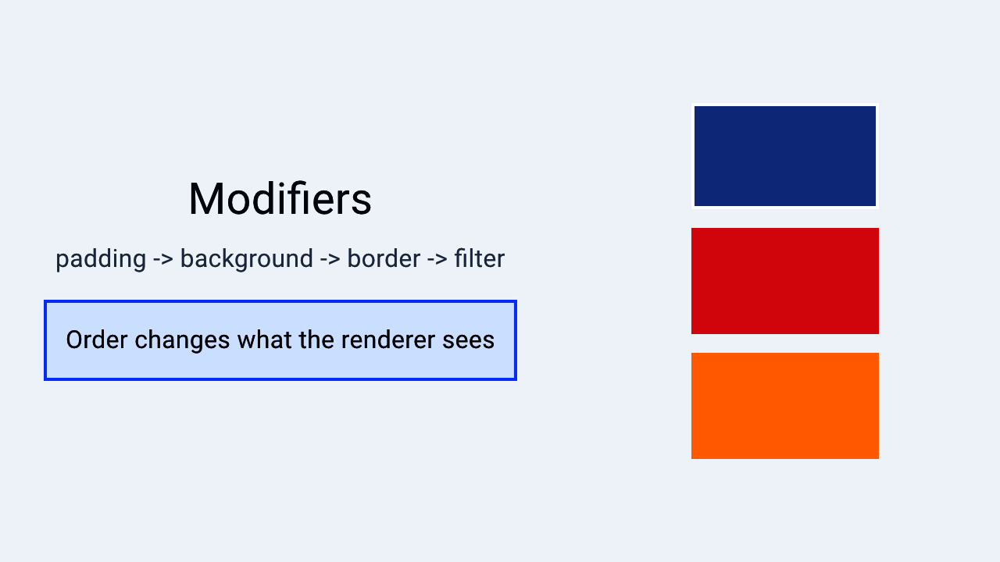

# Modifiers and ViewExt

> **In this chapter, you will:**
> - Understand how modifier chaining builds a nested type, and why order matters
> - Size, pad, and align views, and tell the `Frame` modifiers from the rest
> - Style views with backgrounds, borders, shadows, clips, transforms, and tints
> - Inject state into handlers with `.state(...)` and disable a whole subtree correctly
> - Find any modifier quickly in an index of every `ViewExt` and `FilterViewExt` method

Modifiers are chainable methods that add styling, layout, and behavior to any view. Instead of a constructor with twenty parameters, you describe the view once and layer on the rest:

```rust
use waterui::prelude::*;

fn badge_label() -> impl View {
    text!("Hello")
        .padding()
        .background(Color::blue())
        .on_tap(|| waterui::log::info!("tapped"))
}
```



*A Hydrolysis preview showing how modifier order changes rendered output. [Example source](https://github.com/water-rs/book/tree/main/examples/book-visuals).*

## How modifiers work

Every method on `ViewExt` consumes `self` and returns a new type that wraps it:

```rust,ignore
text!("Hello")                          // Text
    .padding()                          // Padding
    .background(Color::blue())          // BackgroundView<Padding, Color>
    .border(Color::srgb(0, 0, 0), 1.0)  // Metadata<Border>
```

Each step is a typed wrapper, not an entry in a runtime property bag, so passing the wrong kind of argument is a compile error. Most modifiers return a `Metadata<T>` (the content, held as an `AnyView`, plus a typed value `T` a backend reads), an `IgnorableMetadata<T>` (the same, but a backend that does not understand `T` renders the content unchanged), or a small wrapper view such as `Padding` or `Frame`. A few return `impl View` because they compose several others. Because `Metadata<T>` erases its content, the type records the outermost modifier, not the whole chain.

`ViewExt` is blanket-implemented for every view, and it is in the prelude, so `use waterui::prelude::*;` is all you need:

```rust,ignore
pub trait ViewExt: View + Sized { /* ... */ }

impl<V: View + Sized> ViewExt for V {}
```

## Layout modifiers

### padding

`padding()` adds 14 points on every side. `padding_with` takes anything that converts to `EdgeInsets`, reactive or not, and `padding_horizontal` / `padding_vertical` pad one axis:

```rust
use waterui::prelude::*;

fn padded() -> impl View {
    vstack((
        text!("Default").padding(),
        text!("Uniform").padding_with(16.0),
        text!("Vertical, horizontal").padding_with((8.0, 16.0)),
        text!("Top, leading, bottom, trailing").padding_with([4.0, 16.0, 12.0, 16.0]),
        text!("Explicit").padding_with(EdgeInsets::new(10.0, 20.0, 10.0, 20.0)),
    ))
}

fn rails() -> impl View {
    vstack((
        text!("Side rails").padding_horizontal(24.0),
        text!("Top and bottom").padding_vertical(8.0),
    ))
}
```

`EdgeInsets::new` takes `top, leading, bottom, trailing`, the same order as the four-element array. `EdgeInsets::all` and `EdgeInsets::symmetric(vertical, horizontal)` cover the common shapes.

### Size, constraints, and alignment

`width`, `height`, `size`, the `min_*` and `max_*` variants, and `alignment` all wrap the view in a `Frame`:

```rust
use waterui::prelude::*;

fn sized() -> impl View {
    vstack((
        Color::red().width(100.0),
        Color::red().size(100.0, 50.0),
        text!("Bounded").min_size(80.0, 40.0).max_size(300.0, 200.0),
        text!("Top left").width(200.0).height(60.0).alignment(Alignment::TopLeading),
    ))
}
```

On a `Text`, `.size(..)` is the *font* size: `Text`'s own one-argument method shadows the two-argument frame `.size(w, h)`, so size a text frame with `.width(..).height(..)` as above.

The `ViewExt` versions take plain `f32`. `Frame` itself is chainable, and its own methods (`width`, `height`, `ideal_width`, `ideal_height`, `min_*`, `max_*`) accept any `IntoSignalF32`, so a reactive constraint re-runs layout:

```rust
use waterui::prelude::*;

fn reactive_width() -> impl View {
    let column_width = Binding::f32(200.0);

    text!("Hello")
        .alignment(Alignment::Leading) // ViewExt method, returns a Frame
        .width(column_width)           // Frame's own method, reactive
}
```

Each `ViewExt` call starts a new `Frame`, so `text!("A").min_size(80.0, 40.0).max_size(300.0, 200.0)` nests two frames. Calling a method `Frame` has itself, as `.width(column_width)` does above, sets a field on the same frame.

### aspect_ratio and layout_priority

`aspect_ratio(ratio)` fits the view inside what it is offered at a width-to-height ratio. For the filling mode, construct `AspectRatio::new(view, ratio, ContentMode::Fill)` yourself. `layout_priority(i32)` decides who gives way when a stack runs short: the lowest priority is compressed first, and the default is `0`.

```rust
use waterui::prelude::*;

fn priorities() -> impl View {
    hstack((
        text!("A long title that may be squeezed").layout_priority(0),
        text!("Pinned").layout_priority(1),
    ))
}

fn thumbnail() -> impl View {
    Color::blue().aspect_ratio(16.0_f32 / 9.0)
}
```

### Alignment guides

`horizontal_alignment_guide` and `vertical_alignment_guide` override where one view's guide sits. The closure receives the view's `ViewDimensions` and returns the guide position in the view's own coordinates; stacks and frames use it when they line children up. Overriding a guide changes where the child lines up, never how much space it claims.

```rust
use waterui::prelude::*;

fn nudged() -> impl View {
    text!("Shifted guide").horizontal_alignment_guide(HorizontalAlignment::Leading, |dimensions| {
        dimensions.size.width / 4.0
    })
}
```

The contract is in [the layout chapter](../03-ui/02-layout.md) and [the layout engine](../08-internals/03-layout-engine.md).

### ignore_safe_area

Extend past the safe-area insets, for full-bleed backgrounds. The argument is an `EdgeSet`, or `SafeAreaRegions::KEYBOARD.on(EdgeSet::BOTTOM)` to name one region:

```rust
use waterui::prelude::*;

fn full_bleed() -> impl View {
    vstack((
        Color::red().ignore_safe_area(EdgeSet::ALL),
        text!("Title").ignore_safe_area(EdgeSet::TOP),
        text!("Editor").ignore_safe_area(SafeAreaRegions::KEYBOARD.on(EdgeSet::BOTTOM)),
    ))
}
```

## Visual modifiers

### background

`background` accepts anything that implements `IntoBackground`: a `Color`, a gradient, any view, a `Material`, or a `Glass`.

```rust
use waterui::prelude::*;

fn backgrounds() -> impl View {
    vstack((
        text!("Color").background(Color::red()),
        text!("Material").background(Material::Regular),
        text!("Glass").padding().background(Glass::regular()),
        text!("Any view").background(hstack((Color::red(), Color::blue()))),
    ))
}
```

The content determines the layout size and the background stretches to fill it. The split matters for how it renders. A view (including a color or gradient) is composed in Rust as a `BackgroundView`. `Material` and `Glass` instead become `MaterialBackground` and `GlassBackground` metadata that each backend realizes, because they treat the content behind the view. Materials have five levels (`UltraThin`, `Thin`, `Regular`, `Thick`, `UltraThick`). `Regular`, `Thick`, and `UltraThick` treat the window's own content behind the view and work on every mainline backend. `UltraThin` and `Thin` blur what lies behind the window, which is the compositor's job: on Hydrolysis they are only realized as a window background, and as a view's background they panic naming the level. `Glass` has two looks (`Glass::regular()`, `Glass::clear()`) with `.interactive(bool)`, `.tint(color)`, and `.shape(shape)` (a capsule by default). Glass is not a sixth material; it is a separate type. Apple backends project it onto the platform's glass effect, and other backends approximate it or render the content without a background.

`material_group()` makes the materials in a subtree share one capture of what lies behind them, so a style may merge neighboring glass controls into one shape. The nearest enclosing group wins, and a style that does not group materials renders the content unchanged:

```rust
use waterui::prelude::*;

fn toolbar() -> impl View {
    hstack((
        text!("Back").padding().background(Glass::regular()),
        text!("Share").padding().background(Glass::regular()),
    ))
    .material_group()
}
```

### foreground, muted, and tint

These three write theme tokens into the environment, so each reaches every descendant that does not set its own:

```rust
use waterui::prelude::*;

fn colored() -> impl View {
    vstack((
        vstack((text!("Hello"), text!("World"))).foreground(Color::red()),
        text!("Last run: never").caption().muted(),
        button("Delete").action(|| {}).tint(Color::red()),
    ))
}
```

`foreground` overrides the `Foreground` token. `muted()` is `foreground(MutedForeground)`, the color captions and inactive icons share, and `.foreground(Foreground)` restores the primary color below a muted subtree. Both tokens live in `waterui::theme::color`, which the prelude also exports as `theme_color`. `tint` sets the color controls draw their emphasis with: the nearest enclosing tint, or the theme's `Accent` token when none is set. All three take `impl Into<Color>`; for a color that changes, wrap a signal with `signal_color(signal)` (in the prelude, from `waterui::color`), and a change updates the controls in place without rebuilding them.

### opacity and visible

`opacity` accepts any `IntoSignalF32`, a constant or a signal:

```rust
use waterui::prelude::*;

fn faded() -> impl View {
    let alpha = Binding::f32(1.0);

    vstack((text!("Faded").opacity(0.5), text!("Dynamic").opacity(alpha)))
}
```

It maps to compositor-native operations rather than an offscreen GPU pass. `visible(signal)` composes three things: opacity goes to `0.0`, hit testing turns off, and the accessibility state reports the view as hidden, so a hidden view also disappears for screen readers.

### overlay

Draw content on top without affecting the base view's layout. Unlike a `ZStack`, an overlay never influences the size of what is underneath, which makes it the right tool for badges and status dots:

```rust
use waterui::prelude::*;

fn dimmed() -> impl View {
    text!("Hello").overlay(Color::red().with_opacity(0.5))
}
```

For popovers anchored to a view, and for modal dialogs, use `anchored_overlay` and `dialog`; they are covered in [Overlays and dialogs](../03-ui/10-overlays.md).

### shadow

`Shadow::new(color, offset, blur_radius, silhouette)` takes the shape of the element casting the shadow, because backends that rasterize the shadow blur that shape. Pass the shape the view is filled or clipped with, or `Rectangle` for a plain box. `Shadow::splat(value)` builds a black rectangular shadow offset `value` on both axes with blur radius `value`. A plain number `n` also converts into a black rectangular shadow, but offset `n` points straight down, with blur radius `n`:

```rust
use waterui::prelude::*;
use waterui::shape::{Rectangle, RoundedRectangle};

fn shadowed() -> impl View {
    let card_shape = RoundedRectangle::new(0.1);

    vstack((
        text!("Box").shadow(Shadow::new(
            Color::srgb(0, 0, 0).with_opacity(0.3),
            Vector::new(2.0, 2.0),
            4.0,
            Rectangle,
        )),
        text!("Card")
            .padding()
            .background(Color::srgb(255, 255, 255))
            .clip(card_shape)
            .shadow(Shadow::new(
                Color::srgb(0, 0, 0).with_opacity(0.2),
                Vector::new(0.0, 4.0),
                8.0,
                card_shape,
            )),
        text!("Quick").shadow(Shadow::splat(4.0)),
        text!("Dropped").shadow(4.0),
    ))
}
```

`Shadow` and `Vector` live in `waterui::style`, and the prelude re-exports them. `Shadow` keeps its fields private; read them through `color()`, `offset()`, `radius()`, and `silhouette()`.

### border

`border(color, width)` draws a square border on every edge. For rounded corners or selected edges, build a `Border` and pass it to `border_with`:

```rust
use waterui::prelude::*;

fn bordered() -> impl View {
    let custom = Border::new(Color::blue(), 2.0)
        .corner_radius(12.0)
        .edges(EdgeSet::HORIZONTAL);

    vstack((
        text!("Bordered").border(Color::red(), 2.0),
        text!("Custom").border_with(custom),
    ))
}
```

`Border::corner_radius` takes points, unlike `clip`, which is normalized. `Border` is in the prelude and lives in `waterui::border`.

### clip

The shape is normalized to the view's bounds, so `RoundedRectangle::new` takes a corner radius in `0.0..=0.5`, not points. For an absolute radius, use `FixedRoundedRectangle::new(8.0)`:

```rust
use waterui::prelude::*;
use waterui::shape::{Circle, RoundedRectangle};

fn clipped() -> impl View {
    hstack((
        Color::red().size(48.0, 48.0).clip(Circle),
        text!("Card").padding().background(Color::blue()).clip(RoundedRectangle::new(0.1)),
    ))
}
```

### floating

`floating()` promotes a view onto the elevated surface layer: themed container color, clip radius, and a pair of ambient and key shadows that follow the control's interaction state.

```rust
use waterui::prelude::*;

fn compose_button() -> impl View {
    button("Compose").action(|| {}).floating()
}
```

The tokens come from a `FloatingStyle` in the environment, which a theme provides. When there is none, `floating()` falls back to `FloatingStyle::default()`, which is itself expressed in theme tokens (`Surface`, `Accent`, a 44-point minimum target). Override the tokens for one view with `floating_with(style)`, or install your own `FloatingStyle`, which is a `Plugin`.

Presentation stays an attribute: a floating button is still semantically a button, with the same identity and accessibility.

## Transform modifiers

Transforms are purely visual. They change how a view is drawn without touching layout, which is what makes them cheap to animate. Every numeric argument is an `IntoSignalF32`:

```rust
use waterui::prelude::*;

fn transformed() -> impl View {
    let s = Binding::f32(1.0);

    vstack((
        text!("Stretched").scale(2.0, 1.0),
        text!("Bound").scale(s.clone(), s),
        text!("Corner").scale_from(0.5, 0.5, Anchor::TOP_LEFT),
        text!("Dial").rotation_from(90.0, Anchor::TOP_LEFT),
        text!("Arrow").rotation(45.0),
        text!("Badge").offset(10.0, -5.0),
    ))
}
```

`rotation` takes degrees, positive clockwise, around the center. `Anchor` lives in `waterui::style` (the prelude re-exports it), with `CENTER`, `TOP_LEFT`, `TOP_RIGHT`, `BOTTOM_LEFT`, `BOTTOM_RIGHT` and `Anchor::new(x, y)` in normalized coordinates. To animate a transform, bind it to an animated signal; see [Animation](../06-advanced/01-animation.md).

## Interaction modifiers

Tap and long-press recognizers are one-liners; the gesture model itself is in [Gestures](../06-advanced/02-gestures.md):

```rust
use waterui::gesture::TapGesture;
use waterui::prelude::*;

fn taps() -> impl View {
    vstack((
        text!("Click me").on_tap(|| waterui::log::info!("tapped")),
        text!("Double-tap me").on_tap_gesture_count(2, || waterui::log::info!("twice")),
        text!("Press and hold").on_long_press_gesture(500, || waterui::log::info!("held")),
        text!("Triple tap").gesture(TapGesture::repeat(3), || waterui::log::info!("thrice")),
    ))
}
```

`on_tap_gesture` is an alias of `on_tap`. `gesture` attaches any recognizer, and `gesture_observer` attaches a pre-built `GestureObserver`. The long-press duration is in milliseconds.

`hittable` controls whether a view receives pointer events at all, without changing how it looks:

```rust
use waterui::prelude::*;

fn decoration() -> impl View {
    let interactive = Binding::bool(true);

    vstack((
        text!("Click through me").hittable(false),
        button("Maybe").action(|| {}).hittable(interactive),
    ))
}
```

### disabled

`disabled` is not a visual dimming shortcut. It installs a `Disabled` scope into the subtree's environment:

```rust
use waterui::prelude::*;

fn submit_form() -> impl View {
    let is_submitting = Binding::bool(false);
    let name = Binding::container(Str::default());

    vstack((
        TextField::new("Name", &name),
        button("Submit").action(|| {}),
    ))
    .disabled(is_submitting)
}
```

Three things follow. Controls inside the subtree render their **platform-correct disabled appearance** instead of a blanket 50% opacity. The subtree stops hit-testing and reports the disabled state to assistive technologies. And nested scopes **OR-combine**: a control stays disabled while any enclosing `.disabled(...)` is disabled, tracked reactively without rebuilding the subtree. Controls fold the inherited scope into their own configuration through `Disabled::resolve`.

### selected and interaction_state

`selected(signal)` marks the control it modifies as selected: it enters `InteractionState::SELECTED`, so its style's selected values apply and assistive technology announces it. It applies to the control itself, not to controls nested inside it.

`interaction_state(&binding)` goes the other way and reports the state of the control it modifies, or the outermost control inside it, into a `Binding<InteractionState>` whenever it changes. The flags are `HOVERED`, `FOCUSED` (keyboard focus that should be shown), `PRESSED`, `DRAGGED`, `SELECTED`, and `DISABLED`. Use it to style chrome the control does not draw itself, such as a dot that appears while the chip has keyboard focus:

```rust
use waterui::interaction::InteractionState;
use waterui::prelude::*;
use waterui::shape::Circle;

fn chip() -> impl View {
    let state = binding(InteractionState::empty());
    let ring = state.map(|s: InteractionState| {
        if s.contains(InteractionState::FOCUSED) { 1.0_f32 } else { 0.0 }
    });
    let selected = Binding::bool(false);

    button("Filter")
        .action(|| {})
        .selected(selected)
        .interaction_state(&state)
        .overlay(Color::blue().size(8.0, 8.0).clip(Circle).opacity(ring))
        .alignment(Alignment::TopTrailing) // Overlay's own method
}
```

### Drag and drop, keyboard, and menus

`draggable(payload)` and `drop_destination(handler)` move typed values (`Str`, `Url`, `Files`, or your own `Transferable` types) between views; see [Drag and drop](../06-advanced/10-drag-drop.md). `on_key_press(handler)` receives keys the focused view leaves unconsumed, and `focused(&binding, value)` ties focus to a binding; see [Keyboard and focus](../06-advanced/09-keyboard-focus.md). `context_menu` is covered in [Menus](../03-ui/09-menus.md).

## Stateful event handlers

Handlers are extractor-based, exactly like `use_env`. `ViewExt::state` injects a cloneable value into the environment, and the handler pulls it back out with `State<T>`:

```rust
use waterui::prelude::*;

fn hoverable() -> impl View {
    let count = Binding::i32(0);
    let is_hovered = Binding::bool(false);

    text("Hover me")
        .padding()
        .on_hover_enter(
            |State(count): State<Binding<i32>>, State(hovered): State<Binding<bool>>| {
                *count.get_mut() += 1;
                hovered.set(true);
            },
        )
        .on_hover_exit(|State(hovered): State<Binding<bool>>| {
            hovered.set(false);
        })
        .state(&count)
        .state(&is_hovered)
}
```

One `.state(&value)` per injected value, one `State<T>` parameter per value you want back. A handler sees the environment its modified view resolves in, so within one modifier chain the `.state` install may sit before or after the handler, gestures and `on_tap` included. State installed inside a view's own `body` is not part of the chain and stays invisible to the handler. A missing value is a contract violation, not a silent default: a debug build panics naming the type and telling you to install it with `.state(&value)`, and a release build logs it and skips the handler. A handler takes at most eight parameters; when several values belong together, bundle them into one `#[derive(Clone)]` struct and inject that.

`on_hover_enter` and `on_hover_exit` are shortcuts for `event(Event::HoverEnter, ..)` and `event(Event::HoverExit, ..)`; `Event` lives in `waterui::event`. They only fire on platforms with a pointer.

## Feedback modifiers

```rust
use waterui::cursor::CursorStyle;
use waterui::prelude::*;

fn feedback() -> impl View {
    let unread = Binding::i32(5);

    vstack((
        text!("Click me").cursor(CursorStyle::PointingHand),
        text!("Inbox").badge(unread),
    ))
}
```

`cursor` accepts a signal and applies while the pointer is over the view, then reverts. `badge` draws a numeric badge, typically for unread counts, and needs a `Clone` view.

The haptic modifiers require the `std` feature of the `waterui` facade, which is not a default feature, and take an `Intensity` re-exported at `waterui::Intensity`:

```rust,ignore
use waterui::Intensity;

text!("Haptic tap").on_tap_haptic_default(|| { /* ... */ });
text!("Explicit tap").on_tap_haptic(Intensity::MEDIUM, || { /* ... */ });
text!("Hold").on_long_press_haptic_default(500, || { /* ... */ });
text!("Explicit hold").on_long_press_haptic(500, Intensity::MEDIUM, || { /* ... */ });
```

## Lifecycle modifiers

```rust
use waterui::event::LifeCycle;
use waterui::prelude::*;

fn lifecycle_hooks() -> impl View {
    vstack((
        text!("A").on_appear(|| waterui::log::info!("visible")),
        text!("B").on_disappear(|| waterui::log::info!("removed")),
        text!("C").lifecycle(LifeCycle::Appear, || waterui::log::info!("same as on_appear")),
    ))
}
```

`body()` running does not mean the view is on screen, because a lazy container may resolve views ahead of time. Use `on_appear` for work that should start when the view is actually displayed. `on_disappear` fires when the view leaves the hierarchy, not when it is hidden, and it does not mean the view is destroyed; to release resources at that point, keep them alive with `retain`. Lifecycle handlers run once.

`on_change` watches a signal and runs a handler on every change, tied to the view's lifetime. The handler gets the new value first, then any extractors:

```rust
use waterui::prelude::*;

fn search() -> impl View {
    let query = Binding::container(Str::default());
    let last_seen = Binding::container(Str::default());

    TextField::new("Search", &query)
        .on_change(
            &query,
            |value: Str, State(last_seen): State<Binding<Str>>| {
                waterui::log::info!("Search changed to: {value}");
                last_seen.set(value);
            },
        )
        .state(&last_seen)
}
```

Consecutive equal values are collapsed, which is why the signal's output must be `PartialEq + Clone`.

`task` spawns an async task bound to the view's lifetime and cancels it when the view is dropped. The task is spawned when the modifier is called, not when the view mounts:

```rust
use waterui::prelude::*;

fn loading() -> impl View {
    text!("Loading...").task(async {
        waterui::log::info!("background work");
    })
}
```

## Environment and identity modifiers

```rust
use waterui::prelude::*;

fn identity<G: 'static>(guard: G) -> impl View {
    vstack((
        // Type erasure
        text!("Hello").anyview(),
        // Keep a guard alive for the view's lifetime
        text!("Watching").retain(guard),
        // Wrap in a navigation view with a title. `Text` has its own `.title()`
        // font preset, so on a text the modifier is spelled through `ViewExt`.
        ViewExt::title(text!("Body"), "Settings"),
        // Block screenshots of sensitive content
        text!("Secret").secure(),
    ))
}

fn size_picker() -> impl View {
    let size = binding("Medium");

    // `tag` pairs a view with the value that selects it
    Picker::new(
        "Size",
        vec![text("Small").tag("Small"), text("Medium").tag("Medium")],
        &size,
    )
}
```

`tag(value)` returns a `TaggedView`, which is not a view by itself: it is the item a `Picker` takes (`PickerItem<T>` is `TaggedView<T, Text>`) and how a static list row becomes selectable. See [Forms](../03-ui/04-forms.md) and [Lists](../03-ui/05-lists.md).

`with(value)` and `install(plugin)` write into the environment for a subtree; see [the Environment chapter](03-environment.md) and [Plugins](../06-advanced/07-plugins.md). `metadata(key)` attaches a custom `MetadataKey` for a backend to read, which is mostly for [library authors](../08-internals/05-library-authoring.md). `color_space(ColorSpace::Hdr)` and `color_space(ColorSpace::Sdr)` choose the dynamic range of a subtree (`ColorSpace` is in `waterui::metadata::secure`), and `list_min_row_height(points)` sets the floor row height for every list inside a view; `0.0` sizes each row to its content plus insets.

## Accessibility modifiers

Accessibility attributes are modifiers too, and they are ignorable metadata, so a backend that has no use for one renders the view unchanged:

```rust
use waterui::accessibility::AccessibilityRole;
use waterui::prelude::*;

fn labelled() -> impl View {
    let unread = Binding::i32(3);
    let summary = unread.map(|n| Str::from(format!("{n} unread messages")));

    vstack((
        text!("Star").a11y_label("Favorite").a11y_role(AccessibilityRole::Button),
        text!("Inbox").a11y_label(summary),
        text!("Save").a11y_id("save-button"),
        text!("Decoration").a11y_hidden(true),
    ))
}
```

| Modifier | What it sets |
|----------|--------------|
| `a11y_label` | The spoken name; accepts a signal |
| `a11y_value` | The node's own content, announced after the label; accepts a signal |
| `a11y_role` | The `AccessibilityRole` |
| `a11y_id` | A stable automation identifier for `waterui-testing` and native UI tests, invisible to users |
| `a11y_hidden` | Hides the view from assistive technologies |
| `a11y_state`, `a11y_state_signal` | An explicit or reactive `AccessibilityState` |
| `a11y_geometry` | Which rectangle the element reports: `Response` (default), `Allocation`, or `Region(Rect)` |
| `a11y_children` | `AccessibilityChildren::Automatic` or `ExcludeDescendants` |

Always label icon-only controls. Screen readers have nothing else to announce. The full model is in [Accessibility](../06-advanced/05-accessibility.md).

## Filter modifiers

Filters come from `FilterViewExt`, a second extension trait defined in the graphics crate. The prelude exports it when the `effects` feature is on, which `gpu` (a default feature) implies; `effect`, which runs an arbitrary GPU effect, needs `gpu` itself. Numeric filter parameters take an `impl IntoSignalF32`, so a `Binding<f32>` animates the effect without rebuilding the view:

```rust
use waterui::prelude::*;

fn blurred(content: impl View) -> impl View {
    let blur_amount = Binding::f32(0.0);
    content.blur(blur_amount)
}
```

Beyond the general `filter(filter)` and `effect(effect)`, the trait has 66 named filters: color adjustments (`brightness`, `contrast`, `saturation`, `hue_rotation`, `sepia`, `tone_curve`, …), blurs and sharpening (`blur`, `gaussian_blur`, `motion_blur`, `sharpen`, …), edge and morphology kernels, photo effects, distortions, halftones, and image transitions. Some, like `invert` and `sobel`, take no parameter. The index below lists every one; their parameters, ranges, and how filters compose are in [Filters](../05-graphics/04-filters.md).

## Modifier order

Each modifier wraps the previous result, so order changes the outcome:

```rust
use waterui::prelude::*;

fn ordered() -> impl View {
    vstack((
        // The background covers the padded area
        text!("Hello").padding().background(Color::red()),
        // Padding sits outside the background
        text!("Hello").background(Color::red()).padding(),
    ))
}
```

Rules of thumb: layout modifiers before visual ones; gestures after both, so the hit area matches what the user sees; lifecycle hooks anywhere, since they do not affect rendering.

## Modifier index

Every method of `ViewExt` (`waterui/src/view.rs`) and `FilterViewExt` (`waterui/components/visual/graphics/src/effects/filter_view.rs`).

| Category | Modifiers |
|----------|-----------|
| **Layout** | `padding`, `padding_with`, `padding_horizontal`, `padding_vertical`, `width`, `height`, `size`, `min_width`, `max_width`, `min_height`, `max_height`, `min_size`, `max_size`, `alignment`, `horizontal_alignment_guide`, `vertical_alignment_guide`, `aspect_ratio`, `layout_priority`, `ignore_safe_area`, `list_min_row_height` |
| **Visual** | `background`, `material_group`, `foreground`, `muted`, `tint`, `opacity`, `visible`, `overlay`, `shadow`, `border`, `border_with`, `clip`, `floating`, `floating_with`, `color_space` |
| **Transform** | `scale`, `scale_from`, `rotation`, `rotation_from`, `offset` |
| **Interaction** | `on_tap`, `on_tap_gesture`, `on_tap_gesture_count`, `on_long_press_gesture`, `gesture`, `gesture_observer`, `hittable`, `disabled`, `selected`, `interaction_state`, `state` |
| **Feedback** (`std`) | `on_tap_haptic`, `on_tap_haptic_default`, `on_long_press_haptic`, `on_long_press_haptic_default` |
| **Feedback** | `cursor`, `badge` |
| **Event** | `event`, `on_hover_enter`, `on_hover_exit`, `on_key_press` ([keyboard](../06-advanced/09-keyboard-focus.md)), `focused` |
| **Lifecycle** | `lifecycle`, `on_appear`, `on_disappear`, `on_change`, `task` |
| **Presentation** | `context_menu` ([menus](../03-ui/09-menus.md)), `anchored_overlay`, `dialog` (`dialog` feature, default; both in [overlays](../03-ui/10-overlays.md)), `title` ([navigation](../03-ui/07-navigation.md)) |
| **Drag and drop** | `draggable`, `drop_destination` ([drag and drop](../06-advanced/10-drag-drop.md)) |
| **Accessibility** | `a11y_label`, `a11y_value`, `a11y_role`, `a11y_id`, `a11y_hidden`, `a11y_state`, `a11y_state_signal`, `a11y_geometry`, `a11y_children` |
| **Environment and identity** | `with`, `install`, `metadata`, `retain`, `tag`, `secure`, `anyview` |
| **Filter** (`FilterViewExt`, `effects`; `effect` needs `gpu`) | `filter`, `effect`, `blur`, `brightness`, `exposure`, `gamma`, `contrast`, `saturation`, `vibrance`, `grayscale`, `hue_rotation`, `invert`, `sobel`, `prewitt`, `median3x3`, `convolution3x3`, `convolution5x5`, `morphology_min`, `morphology_max`, `morphology_gradient`, `photo_effect_mono`, `photo_effect_noir`, `photo_effect_chrome`, `photo_effect_instant`, `photo_effect_fade`, `photo_effect_process`, `photo_effect_tonal`, `photo_effect_transfer`, `sepia`, `sharpen`, `temperature_tint`, `highlights_shadows`, `motion_blur`, `vignette`, `white_point`, `zoom_blur`, `gaussian_blur`, `color_matrix`, `bloom`, `gloom`, `unsharp_mask`, `bump_distortion`, `pinch_distortion`, `twirl_distortion`, `vortex_distortion`, `perspective_transform`, `perspective_correction`, `pixellate`, `crystallize`, `edge_work`, `dot_halftone`, `line_halftone`, `kaleidoscope`, `mirror_tile`, `blend_with_image`, `masked_blur`, `transition_to_image`, `swipe_transition_to_image`, `radial_transition_to_image`, `zoom_transition_to_image`, `displacement_transition_to_image`, `displacement_warp`, `guided_smooth`, `depth_aware_blur`, `temporal_denoise`, `replace_background`, `lut_color_grade`, `tone_curve` |

Next: [Building UIs](../03-ui/01-text.md), which puts views, state, environment, and modifiers to work on text, layout, controls, forms, and navigation.
