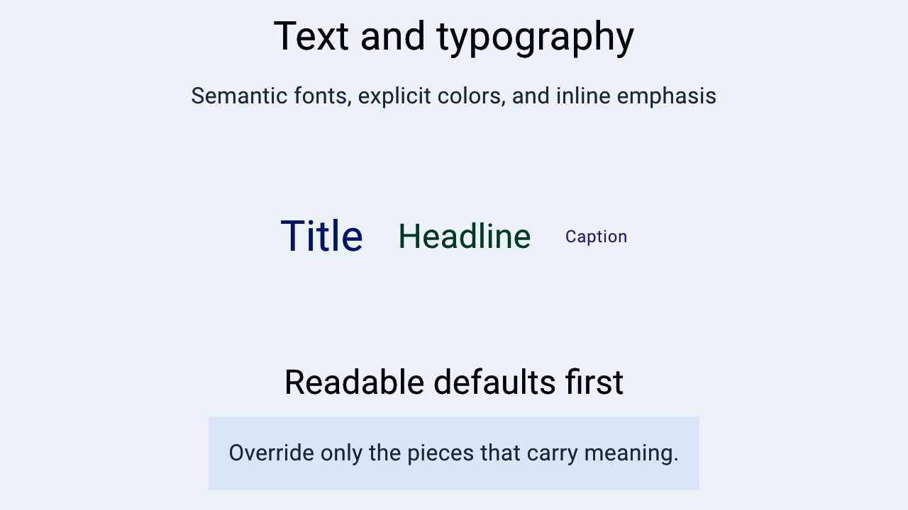

# Text and typography

> **In this chapter, you will:**
> - Display text with `text()` and `text!`, and know which one consults the translation catalog
> - Style text through theme font tokens, weights, monospaced faces, colors, and decorations
> - Compose styled runs with `StyledStr` and render highlighted code with `code`
> - Render Markdown inline, as a block, and as a stream, and know which features each needs

The text API has two entry points. `text()` converts a value into a `Text`; the `text!` macro interpolates named placeholders and looks the format string up in the translation catalog. Fonts, colors, and decorations are builder methods on the `Text` you get back.



*A Hydrolysis preview of WaterUI text rendered with semantic typography and colors. [Example source](https://github.com/water-rs/book/tree/main/examples/book-visuals).*

## What `text()` localizes

`text()` accepts anything implementing `IntoText`, and that conversion decides whether the content is translated:

| Input | Behavior |
|---|---|
| `&'static str` | Looked up in the translation catalog (`Text::localized`) |
| `String`, `Str` | Rendered verbatim, never translated (`Text::verbatim`) |
| `StyledStr` | Rendered verbatim, keeping its per-chunk styling |
| `Computed<T>` / `Binding<T>` where `T: IntoText` | Reactive; re-resolves when the signal changes and when the locale changes |

```rust
use waterui::prelude::*;

fn greeting(name: &Binding<String>) -> impl View {
    vstack((
        text("Hello, World!"), // catalog key
        text(name.clone()),    // reactive, verbatim
    ))
}
```

`Text` sizes itself to its content, so it takes only the space it needs inside a stack. When a parent constrains its width, it wraps to multiple lines. To cap the height instead, call `.line_limit(NonZeroUsize)`; text past the limit is truncated at the last visible line. `.disable_line_limit()` lifts a limit again.

```rust
use std::num::NonZeroUsize;
use waterui::prelude::*;

fn single_line(title: Str) -> impl View {
    text(title).line_limit(NonZeroUsize::MIN)
}
```

## Reactive text with `text!`

`text!` captures named placeholders from the surrounding scope and re-evaluates when the captured signals change:

```rust
use waterui::prelude::*;

fn counter_label(count: &Binding<i32>) -> impl View {
    text!("Count: {count}")
}
```

Only named placeholders are accepted. Name a binding directly (`{count}`) or alias an expression with `name = expr`:

```rust
use waterui::prelude::*;

fn welcome(get_name: impl Fn() -> Str) -> impl View {
    text!("Hello, {name}", name = get_name())
}
```

> **Warning:** `text!` does **not** accept positional `{}` placeholders.
> `text!("Count: {}", count)` is a compile error, because a placeholder name is
> also the key a translator sees.

Format specs work as in `format!`, so `text!("Value: {value:.2}")` rounds to two decimals and stays reactive. Reading a value with `.snapshot()` and passing it to `format!` reads it once at construction time and freezes the output. The point of `text!` is that the framework records the dependency for you.

## Displaying and formatting values

`Text::display` renders any signal whose output implements `Display`:

```rust
use waterui::prelude::*;

fn show_price(price: &Binding<f64>) -> impl View {
    Text::display(price.clone())
}
```

When `Display` is not the presentation you want, implement the `Formatter<T>` trait and pass it to `Text::format`. A formatter is `Clone` and has one method, `fn format(&self, value: &T) -> Str`:

```rust
use waterui::prelude::*;
use waterui::text::Formatter;

#[derive(Clone)]
struct Dollars;

impl Formatter<f64> for Dollars {
    fn format(&self, value: &f64) -> Str {
        Str::from(format!("${value:.2}"))
    }
}

fn price(amount: &Binding<f64>) -> impl View {
    Text::format(amount.clone(), Dollars)
}
```

A formatter sees only the value, never the locale, and `Text::format` does not re-run when the locale changes. For output that follows the locale, use `text!`, which formats interpolated numbers for the active locale, or the number, currency, and date formatters in `waterui::locale` covered in [the i18n chapter](../06-advanced/06-i18n.md).

## Translation catalogs

Place TOML files under `i18n/` in the crate root. The keys are the exact format strings you passed to `text()` or `text!`:

```toml
# i18n/en.toml
"Count: {count}" = "Count: {count}"

# i18n/zh.toml
"Count: {count}" = "计数：{count}"

# i18n/ja.toml
"Count: {count}" = "カウント：{count}"

# i18n/ko.toml
"Count: {count}" = "개수: {count}"
```

The active `Locale` in the environment selects the file. A missing catalog or a missing key is not an error: lookup walks the locale's fallback chain, then `en.toml`, and finally shows the format string itself.

Plural placeholders are written `{#count}` and resolve against a TOML table keyed by the CLDR categories `zero`, `one`, `two`, `few`, `many`, and `other`. Two plural placeholders in the same key form a dual plural whose table keys are `one_one`, `one_other`, `other_one`, and `other_other`. A homograph is disambiguated with a context, `text!("Right" @ "direction")`. The complete grammar, locale switching, and right-to-left layout live in [the i18n chapter](../06-advanced/06-i18n.md).

## Font tokens

Six semantic font tokens are available as builder methods on `Text`:

```rust
use waterui::prelude::*;

fn typography() -> impl View {
    vstack((
        text("Page Title").title(),
        text("Main heading").headline(),
        text("Section header").sub_headline(),
        text("Body content").body(),
        text("Small note").caption(),
        text("Legal text").footnote(),
    ))
}
```

The same tokens exist as values, `font::Title`, `font::Headline`, `font::Subheadline`, `font::Body`, `font::Caption`, and `font::Footnote`, which you pass to `.font()` when the choice is computed:

```rust
use waterui::prelude::*;

fn labelled(is_note: bool) -> impl View {
    if is_note {
        text("Note").font(font::Caption)
    } else {
        text("Note").font(font::Body)
    }
}
```

Each token resolves through the environment, so a platform "Larger Text" setting cascades into your screen without per-call ceremony. A backend installs the framework's default type scale for every slot the application theme leaves unset (`FontSettings::default_scale()` is that scale). Resolving a token against a bare `Environment::new()` that no backend or `Theme` has touched panics with `"<Token> font token is not installed in the environment"`, so install a theme first when you render against a hand-built environment.

Override metrics for your own app through `FontSettings`, which takes a `ResolvedFont` (or a signal of one) per slot, and install it with `Theme::fonts`:

```rust
use waterui::prelude::*;
use waterui::text::font::{FontWeight, ResolvedFont};

fn compact_theme() -> Theme {
    Theme::new().fonts(
        FontSettings::new()
            .body(ResolvedFont::new(15.0, FontWeight::Normal))
            .title(ResolvedFont::new(22.0, FontWeight::SemiBold)),
    )
}
```

`ResolvedFont::with_typography_metrics(line_height, letter_spacing)` sets an absolute line height and tracking. Leaving the line height unset uses the font's own preferred metrics. [The environment chapter](../02-core/03-environment.md) covers installing a theme.

### Direct font overrides

For fixed layouts such as posters, splash screens, and hero headlines, start from a token and override what you need. A direct override escapes the theme's scale, which is why product UI should prefer the tokens:

```rust
use waterui::prelude::*;

fn custom() -> impl View {
    text("Custom").font(
        font::Font::from(font::Body)
            .size(18.0)
            .weight(font::FontWeight::Medium)
            .line_height(24.0)
            .letter_spacing(0.5),
    )
}
```

`Font` also has `.family(..)`, `.design(..)`, `.bold()`, and `.monospaced()`. Every modifier that takes an argument accepts a plain value or a signal; `.bold()` and `.monospaced()` take none. `.family(..)` accepts a name, a `Str`, or a `Binding<Option<Str>>` whose `None` keeps the family the slot resolves to, and `.design(..)` takes a `font::FontDesign` (`Default` or `Monospaced`). `FontWeight` covers the nine standard weights from `Thin` (100) through `Black` (900), with `Normal` (400) as the default.

`Text` carries the common ones as shortcuts. On `Text`, `.size(..)` is the **font size in points**, not a frame, and it accepts a signal. `.weight(..)`, `.italic(..)`, and `.underline(..)` accept signals as well, while `.bold()` and `.monospaced()` take no argument:

```rust
use waterui::prelude::*;

fn highlight(emphasized: &Binding<bool>) -> impl View {
    vstack((
        text("Large bold text").size(28.0).bold(),
        text("May be italic").italic(emphasized.clone()),
        text("let answer = 42;").monospaced(),
    ))
}
```

`.bold()` asks for the platform's bold face, which each backend resolves itself, so on a text-style font such as `.body()` it can be semibold on one platform. Use `.weight(FontWeight::Bold)` when you need an exact weight of 700. `.monospaced()` asks for the platform's fixed-pitch face and keeps the font's slot, size, and weight. It is a design, not a family name.

> **Note:** Because `Text::size` takes one number, giving a text view a *frame* uses a different spelling:
> `text("Title").width(200.0)` and `.height(..)` come from `ViewExt`, or size the container around it.

## Color and alignment

`Text::color` and `Text::background_color` take `impl IntoSignal<Color>`, so pass a `Color` value (a palette constructor, an sRGB value, or a signal of one):

```rust
use waterui::prelude::*;

fn status(accent: &Binding<Color>) -> impl View {
    vstack((
        text("Error message").color(Color::red()),
        text("Success").color(Color::green()),
        text("Highlighted").background_color(Color::yellow()),
        text("Themed").color(accent.clone()),
    ))
}
```

The palette constructors follow the Material color names: `red`, `pink`, `purple`, `deep_purple`, `indigo`, `blue`, `light_blue`, `cyan`, `teal`, `green`, `light_green`, `lime`, `yellow`, `amber`, `orange`, `deep_orange`, `brown`, `grey`, and `blue_grey`.

Product UI should reach for theme tokens first, because they track light and dark mode and any installed palette. `.foreground(..)` sets the inherited foreground for a whole subtree and accepts a token directly. `.muted()` is shorthand for `.foreground(MutedForeground)`:

```rust
use waterui::prelude::*;
use waterui::theme::color::{Accent, MutedForeground};

fn labelled(caption: Str) -> impl View {
    vstack((
        text("Continue").foreground(Accent),
        text(caption).caption().foreground(MutedForeground),
        text("Last synced just now").caption().muted(),
    ))
}
```

`.color()` accepts a token as well, `.color(Accent)`, and then colors only that text's runs instead of the subtree. The full token list is in [the styling chapter](11-styling.md).

`.text_align()` controls paragraph alignment for multi-line text and also takes a signal:

```rust
use waterui::prelude::*;

fn centred_paragraph(body: &Binding<String>) -> impl View {
    text(body.clone()).text_align(HorizontalAlignment::Center)
}
```

## Decorations

`.underline()` accepts any `IntoSignal<bool>`, so the decoration can toggle at runtime:

```rust
use waterui::prelude::*;

fn link_label(highlighted: &Binding<bool>) -> impl View {
    text("Click here").underline(highlighted.clone())
}
```

Strikethrough is a `StyledStr` attribute rather than a `Text` builder:

```rust
use waterui::prelude::*;
use waterui::text::StyledStr;

fn deprecated() -> impl View {
    text(StyledStr::plain("Deprecated").strikethrough(true))
}
```

## Concatenating and composing

`Text` implements `Add` and `AddAssign`, and each side keeps its own styling:

```rust
use waterui::prelude::*;

fn name_row(name: &Binding<String>) -> impl View {
    text("Name: ").bold() + text(name.clone())
}
```

The right-hand side takes anything that implements `IntoText`, including reactive signals and catalog keys, so a concatenation stays reactive and localized.

For finer control, build a `StyledStr` chunk by chunk. Each chunk carries a `Style` holding font, foreground, background, italic, underline, and strikethrough:

```rust
use waterui::prelude::*;
use waterui::text::StyledStr;
use waterui::text::styled::Style;

fn intro() -> impl View {
    let mut styled = StyledStr::empty();
    styled.push("Bold intro: ", Style::default().bold());
    styled.push("normal continuation", Style::default());
    text(styled)
}
```

A `StyledStr` can also carry a tap action over its whole run through `.on_tap(payload, handler)`. The payload is read when the tap fires, so a `Binding` payload reports its latest value.

## Markdown, three ways

Markdown support is opt-in. All three forms below need the `flow-markdown` feature of the `waterui` crate, which is **not** a default feature because it brings a CommonMark parser and a document grammar:

```toml
waterui = { version = "0.5", features = ["flow-markdown"] }
```

The right form depends on whether you need inline styling, a full document, or a document that is still arriving.

### Inline: `StyledStr::from_markdown`

Parses emphasis, strong, strikethrough, inline code, and headings into a single styled run. Block structure collapses into text with blank lines. No layout is involved, so it fits anywhere a `Text` fits, such as a label, a table cell, or a list row:

```rust,ignore
use waterui::prelude::*;
use waterui::text::StyledStr;

fn release_note() -> impl View {
    text(StyledStr::from_markdown("**Bold** and *italic* with `code`"))
}
```

### Block: `RichText`

`RichText::from_markdown` parses a document into a tree of `RichTextElement` values (paragraphs, lists, quotes, images, links, code blocks, and tables) and lays them out as real views. Tables get per-column alignment and shared column origins across rows, so they render as aligned grids. A fenced code block renders through the `code` widget described below. Images load through the `media` feature; without it an image in the document renders nothing and is reported as a contract violation:

```rust,ignore
use waterui::prelude::*;
use waterui::widget::RichText;

fn changelog(source: &str) -> impl View {
    RichText::from_markdown(source)
}
```

For Markdown that ships with your binary, `include_markdown!` reads the file at compile time, relative to the calling source file, and produces the same `RichText`. The prelude exports the macro, so call it bare:

```rust,ignore
use waterui::prelude::*;

fn about() -> impl View {
    include_markdown!("../docs/about.md")
}
```

Inline and display formulas written as `$…$` and `$$…$$` render as typeset math when you also enable the `markdown-math` feature, which pulls in a layout engine and a bundled math font. Without it, a dollar sign is ordinary text. A fence whose info token matches no `Language`, such as ` ```mermaid `, is handed to whichever component crate claims it, and renders as a plain code block when none does. The Mermaid renderer is one such crate and lives in its own repository, so you add it as a separate dependency.

### Streaming: `flow_markdown`

When Markdown arrives token by token, as an LLM response or a log tail does, `flow_markdown` renders it as a reactive list of blocks and patches only the block that changed instead of rebuilding the document. It takes any `IntoComputed<Str>`, so pass the binding itself and keep appending to it:

```rust,ignore
use waterui::prelude::*;

fn assistant_reply(source: &Binding<Str>) -> impl View {
    flow_markdown(source.clone())
        .preset(FlowAnimationPreset::AssistantDefault)
        .stream(FlowStreamMode::AppendOnly)
}
```

`FlowAnimationPreset` offers `AssistantDefault`, `Minimal`, and `None`. `.override_animation(kind, policy)` swaps the policy for one `FlowElementKind` (`Text`, `Heading`, `ListItem`, `Quote`, `CodeBlock`, `Table`, `Image`, `Link`, or `Hr`), where `FlowAnimationPolicy` is `None`, `Fade(Animation)`, or `Typewriter { cps, batch_ms, fade_in }`. `.max_pending_bytes`, `.table_policy`, and `.token_fade_in` tune buffering and entry timing. The same builders exist on `waterui::widget::flow_markdown::FlowMarkdownConfig`, and `.configuration(signal)` swaps the whole configuration reactively.

## Syntax highlighting and code blocks

The `highlight` feature is on by default. It provides `DefaultHighlighter`, a `syntect`-backed highlighter, and the `code` widget. `highlight_text` turns source into a `StyledStr`. The highlighter takes the color scheme whose palette should read against your surface:

```rust
use waterui::prelude::*;
use waterui::text::highlight::{DefaultHighlighter, Language, highlight_text};

fn code_view(source: &str) -> impl View {
    let mut highlighter = DefaultHighlighter::new(ColorScheme::Dark);
    text(highlight_text(Language::Rust, source, &mut highlighter))
        .font(font::Font::from(font::Body).monospaced())
}
```

`Language` covers 38 languages plus `Plaintext`, including Rust, Swift, Kotlin, Python, TypeScript, and Zig. It implements `FromStr` and `TryFrom<&str>` with aliases such as `c++`, `objc`, `shell`, and `yml`, so a fenced-code info string maps straight onto it. `Language`, the `Highlighter` trait, and `HighlightChunk` exist without the feature, so an app that brings its own highlighter keeps the vocabulary.

For a finished code block, with a language caption, a copy button, and the highlighted source on a themed surface, use `code`. It follows the active color scheme and re-highlights when it flips:

```rust
use waterui::prelude::*;
use waterui::text::highlight::Language;
use waterui::widget::code;

fn snippet() -> impl View {
    code(Language::Rust, "fn main() {}")
}
```

`code` also accepts the info token as a string, `code("rust", ..)`, but an unknown token panics, so prefer `Language` unless the token comes from trusted data. The copy button writes to the system clipboard on Windows, Linux, macOS, iOS, Android, and the web, and does nothing elsewhere. `Code` reports nothing on its own after a copy. Attach `.on_copied(|env| ..)` to show feedback, for example through the window's snackbar (see [overlays](10-overlays.md)). Code blocks rendered from Markdown by `RichText` already show a "Copied to clipboard" snackbar when the default `snackbar` feature is on.

## Quick reference

| Method / Function | Purpose |
|---|---|
| `text("...")` | Static text; `&'static str` is localized |
| `text!("Count: {n}")` | Reactive, localized text capturing `n` |
| `Text::display(sig)` | Render any `Signal<Output: Display>` |
| `Text::format(v, fmt)` | Formatted text through a `Formatter` |
| `.title()` / `.headline()` / `.sub_headline()` / `.body()` / `.caption()` / `.footnote()` | Apply a theme font token |
| `.font(f)` | Apply a `Font` or font token (accepts signals) |
| `.size(pt)` / `.weight(w)` / `.bold()` / `.monospaced()` | Direct font overrides |
| `.italic(sig)` / `.underline(sig)` | Toggle decorations reactively |
| `.color(c)` / `.background_color(c)` | Text foreground / background (accept signals) |
| `.text_align(a)` | Paragraph alignment for multi-line text |
| `.line_limit(n)` / `.disable_line_limit()` | Cap or uncap the number of lines |
| `code(lang, src)` | Highlighted code block (`highlight` feature) |
| `RichText`, `include_markdown!`, `flow_markdown` | Markdown (`flow-markdown` feature) |

Now that you can display and style text, it is time to arrange views on screen. [The layout chapter](02-layout.md) covers stacks, frames, grids, and the rest of the layout system.
