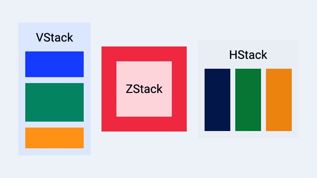

# Layout: stacks, frames, and grids

> **In this chapter, you will:**
> - Arrange views vertically, horizontally, and in layers with `vstack`, `hstack`, and `zstack`
> - Size and space views with `spacer`, padding, frames, and alignment guides
> - Scroll content, drive a scroll position from code, and lay out a grid
> - Place views by coordinate or by edge with `absolute`, and read a view's `StretchAxis` to predict how it grows
> - Build stacks from reactive data without rebuilding them

WaterUI resolves layout through a proposal protocol: a parent proposes a size to each child, the child answers with the size it wants, and the parent places it. You compose that behavior from stacks, spacers, frames, and grids. Every value is a **logical pixel** (point or dp), the same unit as Figma and Sketch; each backend converts to device pixels.

Layout behaves identically on every backend. The rules in this chapter are the contract in the framework's layout specification (`docs/layout-spec.md` in the `waterui` repository), which is frozen: if a backend disagrees with what you read here, the backend has a bug.



*A Hydrolysis preview of WaterUI stack layout primitives. [Example source](https://github.com/water-rs/book/tree/main/examples/book-visuals).*

## Stacks

Three stacks cover most interfaces: `vstack` (top to bottom), `hstack` (leading to trailing), and `zstack` (layered back to front). Each takes a tuple of views.

### `vstack`: vertical layout

```rust
use waterui::prelude::*;

fn profile_card() -> impl View {
    vstack((
        text("Alice").bold(),
        text("Software Engineer"),
        text("San Francisco"),
    ))
}
```

The default spacing is **10pt** and the default horizontal alignment is **center**. A stack never widens itself to its proposal: a column of two labels is as wide as the wider label, wherever it sits. Change spacing and alignment with builder methods, or pass everything to `VStack::new(alignment, spacing, children)`:

```rust
use waterui::prelude::*;

fn left_aligned() -> impl View {
    VStack::new(
        HorizontalAlignment::Leading,
        16.0,
        (text("Left-aligned"), text("Also left-aligned")),
    )
}

fn trailing_8pt() -> impl View {
    vstack((text("Item 1"), text("Item 2")))
        .trailing()
        .spacing(8.0)
}
```

Alignment is a token or a method. `.leading()`, `.centered()`, and `.trailing()` are shorthands for `.alignment(Leading)`, `.alignment(Center)`, and `.alignment(Trailing)`. The tokens convert only into the axis they are legal for, so `vstack(..).alignment(Top)` does not compile: a column aligns horizontally. Leading is the left edge in left-to-right locales and the right edge in right-to-left ones.

### `hstack`: horizontal layout

```rust
use waterui::prelude::*;

fn toolbar() -> impl View {
    hstack((
        text("WaterUI"),
        spacer(),
        button("Settings").action(|| {}),
    ))
}
```

An `hstack` has the same defaults on the other axis: 10pt spacing, children centered vertically. Its alignment methods are `.top()`, `.centered()`, `.bottom()`, `.first_baseline()`, and `.last_baseline()`. The baseline guides line up the text baselines of children set in different sizes rather than their boxes.

```rust
use waterui::prelude::*;

fn baseline_row() -> impl View {
    hstack((text("Total").bold(), text("12 items")))
        .first_baseline()
        .spacing(20.0)
}
```

### When a stack runs out of room

When the children of an `hstack` (or the rows of a `vstack`) want more room than the stack was offered, the stack negotiates instead of crushing whichever child it reaches first. It probes every child for its minimum and maximum extent along the stack's axis. If every child can take what it wants, they get it. If even the minimums overflow, each child gets its minimum and the stack overflows, which layout never clips. Otherwise the children are offered space in **priority bands**, highest first. Inside a band the least flexible child (smallest gap between its maximum and its minimum) is offered space first, and each child is measured once at its offer.

`layout_priority(n)` sets the band; the default is `0`. Raise it on the child that should keep its size while its siblings give way:

```rust
use waterui::prelude::*;

fn headline_row() -> impl View {
    hstack((
        text("你好，世界 / こんにちは世界 / 안녕하세요 세계").layout_priority(1),
        spacer(),
        button("Read").action(|| {}),
    ))
}
```

A `Spacer` defaults to the lowest possible priority, so it only absorbs what the ordinary children leave over. An explicit `layout_priority` replaces that default outright: a `Spacer` raised to `0` negotiates like any other child that stretches.

### `zstack`: layered layout

`zstack` layers children on top of each other; the last child in the tuple draws on top. The stack is as large as its largest child:

```rust
use waterui::prelude::*;

fn badge() -> impl View {
    zstack((
        Color::blue(),
        text("Overlay").bold(),
    ))
}
```

Pass an `Alignment` to control where children sit, or use the two-dimensional methods (`.top_leading()`, `.top()`, `.top_trailing()`, `.leading()`, `.centered()`, `.trailing()`, `.bottom_leading()`, `.bottom()`, `.bottom_trailing()`):

```rust
use waterui::prelude::*;

fn corner_badge(image: impl View, dot: impl View) -> impl View {
    ZStack::new(Alignment::TopTrailing, (image, dot))
}

fn corner_badge_methods(image: impl View, dot: impl View) -> impl View {
    zstack((image, dot)).top_trailing()
}
```

`Alignment` pairs a horizontal guide with a vertical one. The nine constants are `TopLeading`, `Top`, `TopTrailing`, `Leading`, `Center` (the default), `Trailing`, `BottomLeading`, `Bottom`, and `BottomTrailing`; `Alignment::new(horizontal, vertical)` builds any other pairing, baselines included. The same alignment tokens and methods work on `Frame`, `Grid`, and `overlay`.

## Reactive spacing and sizing

Stack spacing, grid spacing, every `Frame` dimension, and every `PinConstraints` edge accept either a number or a signal. With a signal, a change re-runs only that container's layout; the subtree is not rebuilt and no state inside it is lost.

```rust
use waterui::prelude::*;

fn adjustable_row() -> impl View {
    let gap = Binding::container(8.0_f32);
    let widen = gap.clone();

    vstack((
        button("Loosen").action(move || widen.add_assign(4.0)),
        hstack((text("Alice"), text("Bob"), text("Carol"))).spacing(gap),
    ))
}
```

Any numeric type converts through `IntoSignalF32`, so `.spacing(8)`, `.spacing(8.0)`, `.spacing(a_computed)`, and `.spacing(a_binding)` all work. Signals are covered in [Reactive state](../02-core/02-reactive.md).

## Spacer

`spacer()` is a flexible gap that absorbs leftover space. It adapts to its parent: inside an `hstack` it expands horizontally, inside a `vstack` vertically, and inside a `zstack` it claims nothing.

```rust
use waterui::prelude::*;

fn pushed_to_the_edge() -> impl View {
    hstack((
        text("Title"),
        spacer(),
        button("Done").action(|| {}),
    ))
}

fn centred_with_a_floor() -> impl View {
    hstack((spacer_min(20.0), text("Centered"), spacer_min(20.0)))
}
```

`spacer_min(20.0)` behaves the same but keeps at least 20pt on the stack's axis when space runs short. Several spacers share the leftover space by the same rule as every other child.

## Divider

`Divider` is a unit struct, so you write it without parentheses. It draws a 1pt line in the theme's border color, oriented by the stack it sits in: horizontal inside a `vstack`, vertical inside an `hstack`. Outside a stack it is a horizontal rule.

```rust
use waterui::prelude::*;

fn sectioned() -> impl View {
    vstack((
        text("Section 1"),
        Divider,
        text("Section 2"),
    ))
}
```

## Padding

`.padding()` insets a view by 14pt on every side. `.padding_with(..)` takes anything that converts to `EdgeInsets`, and `.padding_horizontal(v)` and `.padding_vertical(v)` pad one axis:

```rust
use waterui::prelude::*;

fn padded() -> impl View {
    vstack((
        text("Default").padding(),
        text("All edges").padding_with(16.0),
        text("Vertical, horizontal").padding_with((8.0, 16.0)),
        text("Top, leading, bottom, trailing").padding_with([4.0, 16.0, 12.0, 16.0]),
        text("Sides only").padding_horizontal(24.0),
    ))
}
```

| You pass                              | Meaning                                |
|---------------------------------------|----------------------------------------|
| a number, `16.0`                      | The same inset on every edge           |
| `(vertical, horizontal)`              | Top and bottom, then leading and trailing |
| `[top, leading, bottom, trailing]`    | Explicit edges, in SwiftUI's order     |
| an `EdgeInsets`, or a signal of one   | The same, reactive in the signal case  |

The explicit constructors (`EdgeInsets::all`, `EdgeInsets::symmetric(vertical, horizontal)`, and `EdgeInsets::new(top, leading, bottom, trailing)`) build the same values when you need to store one. Insets use leading and trailing, so they mirror in right-to-left layouts. Negative insets are legal and let the child extend past the padded box.

## Frame

A frame overrides the proposal a child receives, clamping it to the constraints you set. Most of the time you reach for it through the `ViewExt` shorthands, which take plain numbers:

```rust
use waterui::prelude::*;

fn fixed() -> impl View {
    Color::blue().size(200.0, 100.0)
}

fn bounded() -> impl View {
    text("Bounded")
        .max_width(300.0)
        .max_height(200.0)
        .alignment(Alignment::BottomTrailing)
}

fn fill_the_width() -> impl View {
    Color::red().height(4.0).max_width(f32::INFINITY)
}
```

For signal-driven dimensions or an ideal size, build the `Frame` yourself. It is in `waterui::layout::frame`:

```rust
use waterui::layout::frame::Frame;
use waterui::prelude::*;

fn growing_width(content: impl View) -> impl View {
    let width = Binding::container(120.0_f32);
    let grow = width.clone();

    vstack((
        button("Grow").action(move || grow.add_assign(20.0)),
        Frame::new(content).width(width).top_leading(),
    ))
}
```

| Method                                | Effect                                                           |
|---------------------------------------|------------------------------------------------------------------|
| `.width(w)` / `.height(h)`            | Pins minimum, ideal, and maximum on that axis                    |
| `.size(w, h)`                         | Pins both axes (`ViewExt` shorthand)                             |
| `.min_width(w)` / `.min_height(h)`     | Lower bound on one axis                                          |
| `.max_width(w)` / `.max_height(h)`     | Upper bound on one axis; `f32::INFINITY` opts into filling       |
| `.min_size(w, h)` / `.max_size(w, h)` | Both axes (`ViewExt` shorthand)                                  |
| `.ideal_width(w)` / `.ideal_height(h)` | Size asked for when the parent proposes nothing (on `Frame`)     |
| `.alignment(a)`                       | Where the child sits inside the frame                            |

On `Frame` itself every dimension accepts a signal; the `ViewExt` shorthands take `f32`. A `Text` has its own `.size(..)`, which sets the font size and takes one argument, so it shadows the two-argument frame shorthand: give text a frame with `.width(..)` and `.height(..)`, or wrap it in `Frame::new`. A frame stretches on an axis only when its maximum there is `f32::INFINITY`: `.width(100.0)` and `.max_width(100.0)` do not stretch. If a minimum is larger than the maximum on one axis, the minimum wins. A child larger than its frame overflows it and is not clipped.

> **Tip:** Reach for a frame only when you need an explicit constraint. Most views have a sensible natural size, and stacks already distribute the surplus.

### Aspect ratio

`.aspect_ratio(r)` shrinks a view to the largest box of width-to-height ratio `r` that fits its offer. For the filling mode, which covers the offer and overflows the long axis, construct `AspectRatio` with `ContentMode::Fill`:

```rust
use waterui::prelude::*;

fn thumbnail(photo: impl View) -> impl View {
    photo.aspect_ratio(16.0 / 9.0)
}

fn cover(photo: impl View) -> impl View {
    AspectRatio::new(photo, 1.0, ContentMode::Fill)
}
```

## Alignment guides

Stacks line children up on **guides**: `Leading`, `Center`, and `Trailing` horizontally, and `Top`, `Center`, `Bottom`, `FirstBaseline`, and `LastBaseline` vertically. Every view has a default value for each guide. `horizontal_alignment_guide` and `vertical_alignment_guide` override one guide for a single view without changing its size, receiving the view's measured `ViewDimensions` and returning the guide's position from the view's own leading or top edge:

```rust
use waterui::prelude::*;

fn hanging_label() -> impl View {
    vstack((
        text("Name"),
        text("Hangs half a label to the left")
            .horizontal_alignment_guide(HorizontalAlignment::Leading, |dimensions| {
                dimensions.size.width / 2.0
            }),
    ))
    .leading()
}
```

Inside a stack the guides are not clamped to the child's box: the stack honors a guide that falls outside the child, widens its envelope to include it, and clips nothing. Grid cells, by contrast, clamp a guide to the cell.

## Scrolling

Wrap content that can outgrow its space in a scroll view:

```rust
use waterui::prelude::*;

fn long_page() -> impl View {
    scroll(vstack((
        text("Item 1"),
        text("Item 2"),
        text("Item 3"),
    )))
}
```

| Function               | Direction       |
|------------------------|-----------------|
| `scroll(content)`      | Vertical        |
| `scroll_horizontal(c)` | Horizontal      |
| `scroll_both(c)`       | Both directions |

All three are in the prelude. A scroll view claims the whole offer along its scrolling axis. On the other axis it hugs its content, unless the content itself fills that axis. Content narrower or wider than the viewport is centered on that axis. To scroll a long, data-driven column lazily, use `Lazy::for_each` (see [Dynamic children](#dynamic-children)); for platform-styled lists with sections, selection, and editing, see [Lists and collections](05-lists.md).

### Scrolling programmatically

A `ScrollController<Point>` lets code move the scroll position: a "back to top" button, jumping to a search result, restoring an offset after a refresh.

```rust
use waterui::animation::Animation;
use waterui::prelude::*;

fn jump_to_top(rows: impl View) -> impl View {
    let scroller = ScrollController::new(Point::zero());
    let jump = scroller.clone();
    let glide = scroller.clone();

    vstack((
        button("Back to top").action(move || jump.scroll_to(Point::zero())),
        button("Glide to 600").action(move || {
            glide.animate_to(Point::new(0.0, 600.0), Animation::default());
        }),
        scroll(rows).scroll_controller(&scroller),
    ))
}
```

`scroll_to` jumps in one frame. `animate_to` moves along the animation you pass: `Animation::default()` uses the backend's default scroll motion (the platform's smooth scroll where the backend drives a native scroll view), and any other animation sets its own curve and duration. A later request, or the person scrolling, takes over from an animation still in flight. Each request bumps a generation counter, so asking for an offset the view is nominally already at still scrolls once the user has dragged away from it.

The controller also reports where the view actually is. `position()` is a read-only signal of `Option<ScrollPosition>`: `None` until the backend has laid the view out once, then the latest offset, viewport size, content size, and `at_start()`/`at_end()` flags. Writing to it does not scroll; use `scroll_to`. A follow-the-tail chat view derives its state like this:

```rust
use waterui::prelude::*;

fn is_at_end(controller: &ScrollController<Point>) -> impl Signal<Output = bool> {
    controller.position().map(|p| p.is_some_and(|p| p.at_end()))
}
```

If you only need the offset, for example to lift a toolbar once content passes under it, bind a `Binding<Point>` with `ScrollView::report_offset(&binding)`.

## Grid

`Grid` distributes children into a fixed number of columns, one `row` at a time. The grid functions live in `waterui::layout::grid`. Import them explicitly: the prelude's `row` is the list row from [Lists and collections](05-lists.md), and an explicit import takes precedence over the prelude.

```rust
use waterui::layout::grid::{grid, row};
use waterui::prelude::*;

fn settings_grid() -> impl View {
    grid(2, [
        row((text("Name"), text("Alice"))),
        row((text("Age"), text("30"))),
        row((text("City"), text("SF"))),
    ])
}
```

Given a finite width, every column is `(width - spacing * (columns - 1)) / columns` wide; given an unbounded width, each column is as wide as its widest cell. Each row is as tall as its tallest cell. Default spacing is **8pt** in both directions and cells are centered. `Grid::new(columns, rows)` accepts any iterator of `GridRow`, so rows can come from data:

```rust
use waterui::layout::grid::{Grid, GridRow, row};
use waterui::prelude::*;

fn three_columns(rows: Vec<GridRow>) -> impl View {
    Grid::new(3, rows).spacing(16.0).top_leading()
}

fn properties(pairs: Vec<(&'static str, &'static str)>) -> impl View {
    let rows = pairs
        .into_iter()
        .map(|(key, value)| row((text(key), text(value))));
    Grid::new(2, rows)
}
```

A `GridRow` is only a way to group cells while you build the grid: it has no size or alignment of its own. `Grid::new` and `grid` panic if you ask for zero columns. A grid takes a fixed set of rows; for a collection that changes, use [Dynamic children](#dynamic-children).

## Overlay and background

`overlay` layers a decoration on top of a base view, and `background` puts one behind. In both cases the base alone determines the size, so decorations never disturb the surrounding layout:

```rust
use waterui::prelude::*;

fn avatar_with_badge(avatar: impl View, dot: impl View) -> impl View {
    avatar.overlay(dot).top_trailing()
}

fn highlighted() -> impl View {
    text("Foreground content").padding().background(Color::blue())
}
```

`overlay(base, decoration)` is the same as the method. A decoration is anchored by its own edges: with `.top_trailing()` the badge's top-trailing corner meets the base's top-trailing corner. Use `zstack` instead when both children should contribute to the overall size. `.background(..)` also accepts a `Material`.

## Absolute positioning

For layouts stacks and grids cannot express (floating action buttons, custom popovers, canvas-like surfaces), put children in an `absolute` container and position each with the `PositionExt` methods. `absolute` always fills the space it is given and hands every child the full bounds; the children place themselves.

```rust
use waterui::prelude::*;

fn floating_ui(fab: impl View) -> impl View {
    absolute((
        Color::grey(),
        text("Center").position_in(UnitPoint::CENTER),
        fab.position_in_offset(
            UnitPoint::BOTTOM_TRAILING,
            UnitPoint::BOTTOM_TRAILING,
            -16.0,
            -16.0,
        ),
    ))
}
```

| Method                                      | Description                                           |
|---------------------------------------------|-------------------------------------------------------|
| `.position(x, y)`                           | Center at absolute coordinates                        |
| `.position_anchor(anchor, x, y)`            | Child's anchor point at absolute coordinates          |
| `.position_in(unit)`                        | Center at a fractional position in the parent         |
| `.position_in_anchor(anchor, unit)`         | Child's anchor at a fractional position in the parent |
| `.position_in_offset(anchor, unit, dx, dy)` | Fractional position plus an offset in points          |
| `.pin(constraints)`                         | Edge-based pinning                                    |

`UnitPoint` holds normalized coordinates, where `(0.0, 0.0)` is the top-leading corner and `(1.0, 1.0)` the bottom-trailing one. The nine constants are `TOP_LEADING`, `TOP`, `TOP_TRAILING`, `LEADING`, `CENTER`, `TRAILING`, `BOTTOM_LEADING`, `BOTTOM`, and `BOTTOM_TRAILING`; `UnitPoint::new(x, y)` takes any other value, including ones outside `0.0..=1.0`. Leading and trailing resolve against the layout direction before the child is placed.

### Pin constraints

Pinning positions a child by its distance from the parent's edges:

```rust
use waterui::layout::PinConstraints;
use waterui::prelude::*;

fn fill_with_inset(child: impl View) -> impl View {
    absolute((child.pin(PinConstraints::all(12.0)),))
}

fn corner_dot(dot: impl View) -> impl View {
    absolute((
        Color::grey(),
        dot.pin(
            PinConstraints::new()
                .trailing(12.0)
                .bottom(12.0)
                .width(28.0)
                .height(28.0),
        ),
    ))
}
```

Setting both `leading` and `trailing` computes the width; setting both `top` and `bottom` computes the height. An explicit `.width()` or `.height()` beats the computed extent. With neither, the extent follows the child's own answer. When both edges on an axis are set, `leading` and `top` decide the origin. Like frame dimensions, every constraint accepts a signal.

An `absolute` container is the right choice for a window-filling overlay layer. A content-sized `zstack` anchors its children to its own, smaller bounds.

## Safe areas

Layout keeps content clear of notches, system bars, the home indicator, and the software keyboard. A full-bleed layer opts out with `.ignore_safe_area(..)`. `EdgeSet` names the edges (`ALL`, `NONE`, `TOP`, `BOTTOM`, `HORIZONTAL`, `VERTICAL`), and `SafeAreaRegions` chooses between the container region and the keyboard:

```rust
use waterui::prelude::*;

fn backdrop() -> impl View {
    Color::blue().ignore_safe_area(EdgeSet::ALL)
}

fn editor_under_keyboard(editor: impl View) -> impl View {
    editor.ignore_safe_area(SafeAreaRegions::KEYBOARD.on(EdgeSet::BOTTOM))
}
```

A solid color, gradient, or material used as a `.background(..)` already extends under the safe area on the edges it touches without moving the content it backs.

## `StretchAxis`

Every view reports a `StretchAxis` that tells its parent whether it wants space beyond what it measured:

| Variant      | Meaning                                       |
|--------------|-----------------------------------------------|
| `None`       | Content-sized                                 |
| `Horizontal` | Fills the width, keeps its intrinsic height   |
| `Vertical`   | Fills the height, keeps its intrinsic width   |
| `Both`       | Fills the space it is given                   |
| `MainAxis`   | Fills along the parent stack's main axis      |
| `CrossAxis`  | Fills along the parent stack's cross axis     |

The framework's own views report these:

| View                                              | Axis                                                       |
|---------------------------------------------------|------------------------------------------------------------|
| Text, buttons, other content controls             | `None`                                                     |
| Text field                                        | `Horizontal`                                               |
| Colors and shapes, GPU surfaces, `absolute`, `List` | `Both`                                                  |
| `Spacer`                                          | `MainAxis`                                                 |
| `Divider`                                         | `CrossAxis`                                                |
| `ScrollView`                                      | Its scrolling axis, plus the other axis if its content fills it |
| A frame with `max_*` of `f32::INFINITY`           | That axis                                                  |

A container claims nothing of its own; it reports the union of its children, resolved against its axis. A `vstack` holding a `spacer()` stretches vertically, a `vstack` holding a color stretches in both directions, and a row of labels stretches in neither. Padding, background, overlay, and aspect-ratio wrappers pass their content's axis through.

Stretch is the only way a view claims extra space, and a stack hands the surplus to stretchers only after ordinary content has taken what it measured. Because a stack does not stretch just because it is a stack, a screen that should fill its window needs something in it that does: a `spacer()`, a color, a scroll view, or a frame with an infinite maximum.

> **Tip:** When a view refuses to fill or refuses to shrink, check its stretch axis first. It usually explains the result on its own. The full negotiation, including how placement re-negotiates against the final bounds, is in [the layout engine](../08-internals/03-layout-engine.md).

## Dynamic children

A stack whose children come from data takes a reactive collection and a generator instead of a tuple. Rows take their identity from the collection: a reactive `List` of `Identifiable` items identifies a row by the item's `id`, and an array or static slice identifies a row by its index. Membership changes diff by identity rather than rebuilding the stack.

Rows are never produced by `watch`. Mutate the collection and the matching rows appear, move, or disappear:

```rust
use waterui::Identifiable;
use waterui::component::lazy::Lazy;
use waterui::prelude::*;
use waterui::reactive::collection::List as ReactiveList;

#[derive(Clone, Identifiable)]
struct TodoItem {
    #[id]
    id: u64,
    title: Str,
}

fn todo_list(items: ReactiveList<TodoItem>) -> impl View {
    Lazy::for_each(items, |item| text(item.title))
}

fn todo_column(items: ReactiveList<TodoItem>) -> impl View {
    VStack::for_each(items, |item| text(item.title))
        .spacing(8.0)
        .leading()
}
```

The two forms differ in what they give you:

- `Lazy::for_each(collection, generator)` is a vertical stack wrapped in a scroll view. It realizes rows as they become visible, so it suits long collections. `Lazy::vstack` and `Lazy::hstack` (and `Lazy::vstack_spaced` and `Lazy::hstack_spaced`, which take a fixed spacing) accept a `Views` collection directly.
- `VStack::for_each`, `HStack::for_each`, and `ZStack::for_each` give you an ordinary stack that still takes every stack modifier (`.spacing`, `.leading`, `.padding`). They also lay out lazily, and a lazy stack cannot see its rows before they are realized, so it always reports `StretchAxis::None`, whatever its rows contain. To make one fill, place it in a parent that stretches it: a scroll view, an `absolute` container, or a frame with an infinite maximum.

For a fixed but runtime-length set, `collect` into a stack. `VStack`, `HStack`, and `ZStack` implement `FromIterator` for any view type and erase each item for you; when the closure would return different view types on different branches, erase them yourself with `.anyview()` so the closure has one return type:

```rust
use waterui::prelude::*;

fn tag_row(tags: Vec<&'static str>) -> impl View {
    let stack: HStack<_> = tags.into_iter().map(|tag| text(tag)).collect();
    stack.spacing(6.0)
}
```

### Animating membership

A row animates in and out when you attach a transition to it. `.transition(..)` must be the outermost modifier on the row (or on a `when`/`watch` branch): one beneath `.padding()`, `.width(..)`, or `.background(..)` is never picked up. A removed row leaves the accessibility and hit-test tree immediately, while its visual and its layout slot stay until the animation finishes, and then its siblings move up.

```rust
use std::time::Duration;
use waterui::Identifiable;
use waterui::PropertyTransition;
use waterui::animation::Animation;
use waterui::prelude::*;
use waterui::reactive::collection::List as ReactiveList;

#[derive(Clone, Identifiable)]
struct Entry {
    #[id]
    id: u64,
    title: Str,
}

fn animated_rows(entries: ReactiveList<Entry>) -> impl View {
    VStack::for_each(entries, |entry| {
        text(entry.title)
            .transition(PropertyTransition::opacity())
            .animation(Animation::ease_in_out(Duration::from_millis(250)))
    })
    .spacing(4.0)
}
```

Transitions and animation curves are covered in [Animation](../06-advanced/01-animation.md).

## What to read next

- [Buttons and controls](03-controls.md), where these layouts get something to arrange
- [Lists and collections](05-lists.md) for platform-styled, sectioned, editable collections
- [Modifiers](../02-core/04-modifiers.md) for the rest of the `ViewExt` toolbox
- [The layout engine](../08-internals/03-layout-engine.md) for how measurement and placement work underneath
