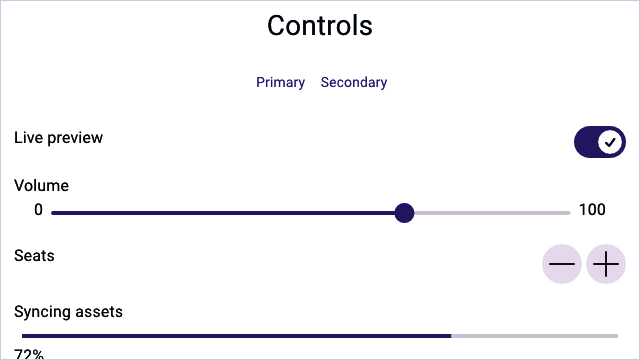

# Buttons and controls

> **In this chapter, you will:**
> - Give every control a semantic `Label`, and hide it visually when the design calls for it
> - Wire button actions to reactive state with `.action()`, `.action_async()` and the `State<T>` extractor
> - Use `Toggle`, `Slider`, `Stepper`, and `TextField` for primary user input
> - Show determinate and indeterminate work with `progress` and `loading`
> - Disable a single control or an entire subtree from a signal

Every WaterUI control has the same shape: a constructor that demands a semantic label, builder methods for configuration, and either a reactive binding carrying values in and out or an action closure fired on activation.



*A Hydrolysis preview of WaterUI controls rendered from real bindings. [Example source](https://github.com/water-rs/book/tree/main/examples/book-visuals).*

All of the free functions in this chapter (`button`, `toggle`, `slider`, `stepper`, `field`, `label`, `progress`, `loading`) and the types behind them (`Button`, `ButtonStyle`, `Toggle`, `ToggleStyle`, `Slider`, `Stepper`, `TextField`, `Label`, `LabelDisplayMode`, `ControlSize`, `Progress`) are in `waterui::prelude`.

## Labels come first

A control's label is not decoration. Screen readers, voice control, and command palettes all read it to announce and activate the control, so the label sits in the constructor signature rather than in a builder method you might forget.

Anything that converts into semantic text is a label: `&'static str`, `String`, `Str`, `Text`, `StyledStr`, a `Binding` or `Computed` of those, and a `Label` itself. That is the `IntoLabel` trait, and the free functions accept it directly:

```rust
use waterui::prelude::*;

fn save_button() -> impl View {
    button("Save").action(|| {})
}
```

A `text!` value is a `Text`, so a button title can follow a signal without any `watch`:

```rust
use waterui::prelude::*;

fn tap_counter(taps: &Binding<i32>) -> impl View {
    let title = taps.clone();
    button(text!("Taps: {title}"))
        .action(|State(taps): State<Binding<i32>>| *taps.get_mut() += 1)
        .state(taps)
}
```

For a label that carries an icon, build it with the `label(...)` free function and decorate it:

```rust
use waterui::prelude::*;
use waterui::icon::system_icon;

fn add_button() -> impl View {
    button(label("Add item").icon(system_icon::plus())).action(|| {})
}
```

`.icon(...)` takes any `View + Clone`, and `.system_icon(...)` takes a `SystemIcon` directly. `.trailing()` moves the icon after the text (`.leading()` is the default), and `.spacing(...)` and `.font(...)` adjust the arrangement.

`Label::new(spoken_text, content)` is the general constructor. It takes the text that assistive technology announces plus a *builder* for the visual content: a closure returning a view, because a control may realize its label more than once (a list row rebuilds it each time it scrolls back into view). Reach for it only when the visual content and the spoken text genuinely differ.

```rust
use waterui::prelude::*;
use waterui::icon::system_icon;

fn account_button() -> impl View {
    button(Label::new("Verified account", || {
        hstack((text("Account"), system_icon::checkmark()))
    }))
    .action(|| {})
}
```

The two label kinds are not interchangeable. `.icon()`, `.system_icon()`, `.leading()`, `.trailing()`, `.spacing()`, and `.font()` describe how a *semantic* label arranges its text and icon, so they **panic** on a `Label::new` label. Style arbitrary content inside the closure you pass to `Label::new` instead.

> **Platform note:** `system_icon` renders SF Symbols on Apple platforms and is
> intentionally unsupported where the platform has no system icon catalog, such
> as Android. For portable icons, pass an icon-pack view to `.icon(...)` from a
> crate such as `waterui-icons-lucide` or `waterui-icons-material-icon`. See
> [the icons chapter](12-icons.md).

### Hiding a label without losing it

`.hide_label()` collapses the visible label to zero size while the semantic text stays in the accessibility tree. Use it for icon-only toolbars and for controls whose meaning is obvious from an adjacent icon. It exists on `Button`, `Toggle`, `Slider`, `Stepper`, and `TextField`:

```rust
use waterui::prelude::*;
use waterui::icon::system_icon;

fn rating_row(rating: &Binding<f64>) -> impl View {
    hstack((
        system_icon::star(),
        slider("Rating", rating).hide_label(),
    ))
}
```

`LabelDisplayMode` names the presentations: `Automatic`, `TitleAndIcon`, `TitleOnly`, `IconOnly`, and `Hidden`. `.hide_label()` is the shorthand for `Hidden`. Set a mode per control with `.label_style(...)`, or install one on a whole subtree as a plugin:

```rust
use waterui::prelude::*;
use waterui::icon::system_icon;

fn toolbar() -> impl View {
    hstack((
        button(label("Search").icon(system_icon::search())).action(|| {}),
        button(label("Settings").icon(system_icon::settings())).action(|| {}),
    ))
    .install(LabelDisplayMode::IconOnly)
}
```

A control's own `.label_style(...)` wins over an installed mode. `IconOnly` applies to labels that have an icon; a label without one keeps showing its title.

### Two constructors per control

`Button::new`, `Slider::new`, and `Stepper::new` take a fully built `Label`; the free functions `button(...)`, `slider(...)`, and `stepper(...)` take any `IntoLabel` and do the conversion for you. `Toggle::new(label, &binding)` and `TextField::new(label, &binding)` already take `impl IntoLabel`, so `toggle(...)` and `field(...)` are the same call under a shorter name. Prefer the free functions unless you already hold a `Label`.

### Control size

`ControlSize` (`ExtraSmall`, `Small`, `Medium`, `Large`, `ExtraLarge`) is a semantic choice, like the style: a backend that scales a control through sizes changes its height, padding and icon size together. `Button`, `Toggle`, and `Slider` take `.size(...)`. When you pick none, a button and a toggle draw at `Small` and a slider at `ExtraSmall`; a backend with fewer sizes maps these onto its own.

## Button

### Simple action

```rust
use waterui::prelude::*;

fn dismiss() -> impl View {
    button("Dismiss").action(|| {
        // Handle click.
    })
}
```

### Reactive state via `.state()` and `State<T>`

An action closure receives its arguments through extraction, not capture. Inject the binding into the button's environment with `.state(&value)`, then pull it back out inside the action with the `State<T>` extractor:

```rust
use waterui::prelude::*;

fn increment(counter: &Binding<i32>) -> impl View {
    button("Increment")
        .action(|State(count): State<Binding<i32>>| {
            *count.get_mut() += 1;
        })
        .state(counter)
}
```

`get_mut()` returns a guard that writes back on drop, so read-modify-write takes one statement instead of a `get`/`set` pair.

Chain `.state()` once per value the action needs. Parameters of the same state type bind positionally: the first `.state()` call feeds the first parameter of that type, the second feeds the second.

```rust
use waterui::prelude::*;

fn discard_button(draft: &Binding<Str>, is_dirty: &Binding<bool>) -> impl View {
    button("Discard")
        .action(|State(draft): State<Binding<Str>>, State(dirty): State<Binding<bool>>| {
            draft.set(Str::default());
            dirty.set(false);
        })
        .state(draft)
        .state(is_dirty)
}
```

`.state()` is a `ViewExt` method, so it wraps the button in a generic view that no longer has the button's builder methods: call it after `.action()`, `.style()` and the rest. A handler sees the environment its view resolves in, so the injected value still reaches the action. The same machinery drives every callback in the framework (`.on_tap`, gestures, drops, menu commands), and for the `ViewExt` handlers such as `.on_tap` the `.state()` call may sit before or after the handler in the chain.

### Owned state types with `#[state]`

`State<T>` is the wrapper for a type your app does not own, such as `Binding` or a third-party value. A `Clone` type your app does own gets `#[state]` once and is then written bare in handler parameters:

```rust
use waterui::prelude::*;

#[state]
#[derive(Clone)]
struct Editor {
    draft: Binding<Str>,
    saved: Binding<bool>,
}

fn save(editor: Editor) {
    editor.saved.set(true);
    waterui::log::debug!(len = editor.draft.snapshot().len(), "saved");
}

fn save_button(editor: &Editor) -> impl View {
    button("Save").action(save).state(editor)
}
```

Beyond two or three pieces of state, group them in one `#[state]` struct, inject it once, and write handlers as plain named functions.

### Environment extraction

A type marked as an environment extractor is read straight from the environment, with no `State` wrapper. The `NavigationController` that a navigation stack provides to its content is the common case:

```rust
use waterui::prelude::*;
use waterui::navigation::NavigationController;

fn back_button() -> impl View {
    button("Go back").action(|nav: NavigationController| nav.pop())
}
```

Your own `Clone` type becomes such an extractor with `waterui::impl_extractor!(MyType)`, and `Use<T>` reads any other `Clone` value installed in the environment. Environment extractors and `State<T>` parameters mix freely in one closure. See [the environment chapter](../02-core/03-environment.md) for how values get installed.

### Async actions

`action_async` spawns the returned future on the local executor, so the handler can await network or file I/O:

```rust
use waterui::prelude::*;

async fn fetch_from_server() -> Str {
    Str::from("payload")
}

fn fetch_button(result: &Binding<Str>) -> impl View {
    button("Fetch data")
        .action_async(|State(result): State<Binding<Str>>| async move {
            result.set(fetch_from_server().await);
        })
        .state(result)
}
```

### Button styles

`ButtonStyle` sets visual emphasis, and the backend decides how each style is drawn.

| Style               | Use for                                                        |
|---------------------|----------------------------------------------------------------|
| `Automatic`         | Platform default (the default)                                 |
| `Plain`             | Low-emphasis actions, toolbar buttons                          |
| `Link`              | Text-based links and URL navigation                            |
| `Borderless`        | No border, but hover and press feedback                        |
| `Bordered`          | Secondary actions                                              |
| `BorderedProminent` | The one primary action on a screen                             |
| `Glass`             | A Liquid Glass capsule floating over content                   |
| `GlassProminent`    | A Liquid Glass capsule filled with the accent color            |

Glass is an Apple primitive. A backend without it draws `Glass` as its bordered style and `GlassProminent` as its bordered-prominent style.

Apply a style with `.style(...)` or one of the shorthands `.plain()`, `.link()`, `.borderless()`, `.bordered()`, and `.bordered_prominent()`:

```rust
use waterui::prelude::*;

fn cta_row() -> impl View {
    hstack((
        button("Continue").bordered_prominent().action(|| {}),
        button("Cancel").bordered().action(|| {}),
        button("Learn more").link().action(|| {}),
        button("Pay").style(ButtonStyle::GlassProminent).action(|| {}),
    ))
}
```

`ButtonStyle` is also a plugin. Installing one on a subtree makes it the default for every button below that did not pick a style itself:

```rust
use waterui::prelude::*;

fn toolbar_buttons() -> impl View {
    hstack((
        button("Undo").action(|| {}),
        button("Redo").action(|| {}),
    ))
    .install(ButtonStyle::Borderless)
}
```

`.accessibility_label(...)` replaces only the spoken text of a button while its visible label stays as it is.

Menus reuse buttons: a `Button` converts into a menu command, so one definition can serve a toolbar and a menu. [The menus chapter](09-menus.md) covers `Menu`, `Command`, shortcuts and context menus.

## Toggle

`Toggle` is a boolean control backed by a `Binding<bool>`. `Toggle::new` and `toggle` both take the label first, then the binding:

```rust
use waterui::prelude::*;

fn settings(wifi: &Binding<bool>, dark_mode: &Binding<bool>) -> impl View {
    vstack((
        toggle("Wi-Fi", wifi),
        Toggle::new("Dark mode", dark_mode).checkbox(),
    ))
}
```

`ToggleStyle` chooses the presentation: `Automatic`, `Switch` (sliding pill), or `Checkbox`. `.switch()` and `.checkbox()` are shorthands for `.style(...)`. `Automatic` resolves to a checkbox on macOS and a switch elsewhere, so state the style when the design depends on it. A switch with a visible label fills the width it is offered, with the label leading and the switch trailing; a checkbox, or a toggle whose label is hidden, sizes to its content.

## Slider

`Slider` selects an `f64` from a continuous range. The default range is `0.0..=1.0`; `.range(...)` overrides it with a `RangeInclusive<f64>`:

```rust
use waterui::prelude::*;

fn volume_slider(volume: &Binding<f64>) -> impl View {
    slider("Volume", volume).range(0.0..=100.0)
}
```

`.step(n)` moves the value in increments of `n` anchored at the start of the range, and `.value_indicator(...)` formats the readout shown above the thumb while it is dragged. `.step` panics on a step that is not positive and finite.

```rust
use waterui::prelude::*;

fn rating_slider(rating: &Binding<f64>) -> impl View {
    slider("Rating", rating)
        .range(0.0..=10.0)
        .step(0.5)
        .value_indicator(|value| Str::from(format!("{value:.1}")))
        .size(ControlSize::Large)
}
```

`.min_value_label(...)` and `.max_value_label(...)` add captions at the ends of the track; each takes an `IntoLabel`:

```rust
use waterui::prelude::*;

fn brightness_slider(brightness: &Binding<f64>) -> impl View {
    slider("Brightness", brightness)
        .min_value_label("Dark")
        .max_value_label("Bright")
}
```

A slider stretches horizontally to fill the space it is offered.

## Stepper

`Stepper` drives an `i32` with +/- buttons, suited to quantities, seat counts, and small numeric adjustments:

```rust
use waterui::prelude::*;

fn item_stepper(count: &Binding<i32>) -> impl View {
    stepper("Items", count).range(1..=10).step(1)
}
```

A stepper shows its label and its +/- buttons but not the value until you add `.value_formatter(...)`, which renders the formatted current value next to the buttons. The formatter returns anything convertible to `StyledStr` (`String` and `Str` both are) and never affects the semantic label:

```rust
use waterui::prelude::*;

fn temperature_stepper(temperature: &Binding<i32>) -> impl View {
    stepper("Temperature", temperature)
        .value_formatter(|v| format!("{v}°C"))
        .range(-20..=50)
        .step(5)
}
```

`.range(...)` accepts any `RangeBounds<i32>`, so `1..=10`, `1..11`, and `1..` all work. `.step(...)` takes a signal (`impl IntoComputed<i32>`), so the increment can itself change with state; a plain `5` works too.

## TextField

`TextField` is a text input backed by a `Binding<Str>`. `field(label, &binding)` is the short form of `TextField::new`. `.prompt(...)` sets the placeholder shown while the field is empty, which is not the label: the label names the field for assistive technology, the prompt only hints at what to type.

```rust
use waterui::prelude::*;

fn username_field(username: &Binding<Str>) -> impl View {
    field("Username", username).prompt("Enter your name")
}
```

### Styled text

For rich text editing, bind a `StyledStr` and construct the field with `TextField::styled(label, &binding)`. `TextField::new` maps a plain `Binding<Str>` internally and panics if a backend writes styled text back into it, so use `styled` whenever styling is possible:

```rust
use waterui::prelude::*;
use waterui::text::styled::StyledStr;

fn rich_field(value: &Binding<StyledStr>) -> impl View {
    TextField::styled("Notes", value)
}
```

### Lines, submit, and keyboards

`.line_limit(n)` caps the field at `n` lines; it takes a `NonZeroUsize`, so zero lines is rejected by the type. `.disable_line_limit()` removes the cap, and the default is a single line. A capped field refuses an edit that would push it past the limit rather than truncating what is already there, and a multi-line field reports the multi-line text-input role to assistive technology.

`.on_submit(handler)` runs a handler, with the same extraction as a button action, when the user presses Return or Enter. In a field without a line limit Return inserts a line break and never submits. A field with no `on_submit` leaves Return unconsumed, so it bubbles to ancestors like any other unused key.

`.keyboard(KeyboardType)` picks the on-screen keyboard (`Text`, `Email`, `URL`, `Number`, `PhoneNumber`); platforms without a software keyboard ignore the hint. `.content_type(ContentType)` declares what the field means for autofill and password services, such as `Username`, `Password`, `NewPassword`, `EmailAddress`, or `OneTimeCode`. It is a semantic attribute and not a keyboard layout, so a one-time-code field typically pairs both:

```rust
use std::num::NonZeroUsize;

use waterui::component::text_field::{ContentType, KeyboardType};
use waterui::prelude::*;

fn code_field(code: &Binding<Str>) -> impl View {
    field("Verification code", code)
        .keyboard(KeyboardType::Number)
        .content_type(ContentType::OneTimeCode)
        .on_submit(|| waterui::log::debug!("code submitted"))
}

fn notes_field(notes: &Binding<Str>) -> impl View {
    field("Notes", notes)
        .prompt("Anything worth remembering")
        .line_limit(NonZeroUsize::new(6).expect("six is non-zero"))
}
```

### Selection menu

`.selection_menu(...)` adds custom entries to the text-selection menu. It accepts any `MenuView`: a `Button`, `Command`, `Menu` or `Divider`, or a tuple, array, `Vec` or `Option` of them. The entries run with the field's live selection installed in their environment, so a handler declares a `TextSelection` parameter and edits the field through it:

```rust
use waterui::prelude::*;

fn field_with_menu(value: &Binding<Str>) -> impl View {
    field("Snippet", value).selection_menu(button("Uppercase").action(
        |selection: TextSelection| {
            let upper = selection.selected_text().to_uppercase();
            selection.replace(&upper);
        },
    ))
}
```

`TextSelection` answers at call time, so a command never works on a snapshot the user has already moved past. Its `text()`, `range()` and `selected_text()` read the field (ranges are byte offsets on UTF-8 boundaries), `replace(&str)` swaps the selection and collapses the caret after the inserted text, `select(range)` moves it, and `styled_value()` returns the field's styled binding, when it has one, for commands that restyle a span instead of replacing text. Declare the parameter as `Option<TextSelection>` to tolerate a backend that installs none.

Password entry (`SecureField`), pickers, and validation live in [the forms chapter](04-forms.md).

## Progress and loading

`progress(value)` shows how far an operation has come. The value is a fraction from `0.0` to `1.0`, and it accepts any signal (`impl IntoComputed<f64>`), so the bar follows a `Binding<f64>` with no `watch`. The default style is a linear bar with a localized label and a percentage readout:

```rust
use waterui::prelude::*;

fn download_bar(fraction: &Binding<f64>) -> impl View {
    progress(fraction.clone()).label("Downloading")
}
```

`.circular()` and `.linear()` switch the shape, and `.total(...)` treats the value as a count measured against a total instead of a fraction:

```rust
use waterui::prelude::*;

fn upload_ring(sent: &Binding<f64>, size: &Binding<f64>) -> impl View {
    progress(sent.clone())
        .total(size.clone())
        .circular()
        .label("Uploading")
}
```

When there is no way to say how far along the work is, use `loading()`. It draws the platform's indeterminate indicator, such as a spinner, or Material's morphing shape under the Material theme:

```rust
use waterui::prelude::*;

fn waiting() -> impl View {
    loading()
}
```

Unlike the other controls, `Progress` takes its label through the `.label(...)` modifier and not at construction, because it ships with a default one. A linear progress stretches horizontally; the circular and loading styles size to themselves. The loading style draws no determinate value even when the progress carries one (`progress(value).loading()`), since it has no track to fill; the value still reaches assistive technology. `.four_color()` switches an indeterminate indicator to the Material four-color cycle.

## Disabling controls

Disabled state is a property of the surrounding context, not of an individual control. `.disabled(...)` from `ViewExt` works on *any* view. There is no per-control `disabled` builder to learn, and no control can forget to honor it:

```rust
use waterui::prelude::*;

fn save_button(is_saving: &Binding<bool>) -> impl View {
    button("Save").action(|| {}).disabled(is_saving.clone())
}
```

The modifier installs a `Disabled` scope in the environment, stops the subtree from hit-testing, and reports the disabled state to assistive technology. Every control reads the state in force at its own position, the same way it reads a theme color. Nested scopes OR-combine: a control is disabled while *any* enclosing scope is `true`.

```rust
use waterui::prelude::*;

fn audio_panel(locked: &Binding<bool>, muted: &Binding<bool>, volume: &Binding<f64>) -> impl View {
    vstack((
        toggle("Mute", muted),
        slider("Volume", volume),
    ))
    .disabled(locked.clone())
}
```

Flipping `locked` re-enables the panel without rebuilding it, because the combined signal is tracked reactively.

A menu `Command` is the one place the state travels as data rather than as context: a menu is a list of command records handed to the platform's menu API, not a rendered subtree, so there is no leaf environment to read from. `Command::disabled(...)` still combines with an enclosing scope when the command resolves. See [the menus chapter](09-menus.md).

## Reference

| Control     | Constructor                                              | Value                                  | Stretch axis                                         |
|-------------|----------------------------------------------------------|----------------------------------------|------------------------------------------------------|
| `Button`    | `button(label)` / `Button::new(Label)`                   | action closure                         | None                                                 |
| `Toggle`    | `toggle(label, &b)` / `Toggle::new(label, &b)`           | `Binding<bool>`                        | Horizontal for a labeled switch, otherwise None      |
| `Slider`    | `slider(label, &b)` / `Slider::new(Label, &b)`           | `Binding<f64>`                         | Horizontal                                           |
| `Stepper`   | `stepper(label, &b)` / `Stepper::new(Label, &b)`         | `Binding<i32>`                         | Horizontal with a visible label, otherwise None      |
| `TextField` | `field(label, &b)` / `TextField::new` / `::styled`       | `Binding<Str>` / `Binding<StyledStr>`  | Horizontal                                           |
| `Progress`  | `progress(value)` / `loading()`                          | `impl IntoComputed<f64>`               | Horizontal when linear, otherwise None               |

A labeled switch and a labeled stepper place their label on the leading edge and the switch or buttons on the trailing edge, with flexible space between. `Button` sizes itself to its label. The stretch rules are part of the frozen layout contract described in [the layout chapter](02-layout.md).

## Where next

Selection controls such as `Picker`, `DatePicker`, `ColorPicker`, and `SecureField` live in the form crate. [The next chapter](04-forms.md) covers them, along with the `#[form]` derive that generates an entire editing UI from a Rust struct. To make these controls match a brand, see [the styling chapter](11-styling.md).
