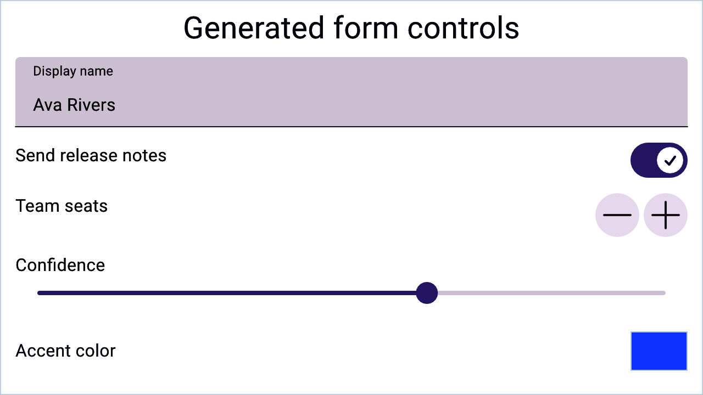

# Forms and data entry

> **In this chapter, you will:**
> - Generate a whole form from a Rust struct with `#[form]` and know which field types map to which control
> - Drive individual fields yourself by projecting a struct binding
> - Choose between `Picker`, `DatePicker`, `Calendar`, `ColorPicker`, `FilePicker` and `SecureField`
> - Attach validators to a control with `ValidatableView`
> - Read form values safely when the user submits

Data entry is the part of an app where the type of a value already says which control the user needs: a `bool` is a switch, a number is a stepper or a slider, a date is a calendar. WaterUI uses that. Put `#[form]` on a struct and every field gets a control chosen by its type, a label derived from its name, and a binding wired straight back into the struct. When the generated layout is not what you want, the same controls are plain constructors you place yourself.



*A Hydrolysis preview of stable WaterUI data-entry controls used by forms. [Example source](https://github.com/water-rs/book/tree/main/examples/book-visuals).*

## A form from a struct

`#[form]` derives `Default`, `Clone`, `Debug`, `FormBuilder` and `Project` for a struct with named fields. `form()` turns a `Binding` of that struct into a view:

```rust
use waterui::prelude::*;

#[form]
pub struct UserProfile {
    /// Display name
    pub name: String,
    /// Account active status
    pub active: bool,
    /// User's current level
    pub level: i32,
}

fn profile_editor() -> impl View {
    let profile = UserProfile::binding();
    form(&profile)
}
```

`UserProfile::binding()` is a `Binding<UserProfile>` that starts from `Default`. To pre-fill the form, build the binding from a value instead:

```rust
use waterui::prelude::*;

# #[form] pub struct UserProfile { pub name: String }
fn edit_profile(initial: UserProfile) -> impl View {
    let profile = Binding::container(initial);
    form(&profile)
}
```

The derive stacks one control per field in a `vstack`. The label is the field name converted from `snake_case` to `Title Case`, and the field's doc comment becomes the prompt of a text field. See [Reactive state](../02-core/02-reactive.md) for what a `Binding` is and [Controls](03-controls.md) for the controls the form is made of.

### Type-to-control mapping

`FormBuilder` is implemented for exactly these types:

| Rust type | Control | Notes |
|---|---|---|
| `String`, `Str` | `TextField` | The doc comment is the prompt |
| `bool` | `Toggle` | |
| `i32` | `Stepper` | Range `i32::MIN..=i32::MAX` |
| `f64` | `Slider` | Range `0.0..=1.0` |
| `f32` | `Slider` | Range `0.0..=1.0`, mapped through `f64` |
| `Color` | `ColorPicker` | Without alpha or HDR |

Any other field type (`u32`, `i64`, `Option<T>`, an enum) has no `FormBuilder` implementation and does not compile inside a derived form. Convert the field to a type in the table, or implement `FormBuilder` for a newtype around it. A field whose type is itself a `#[form]` struct is fine, because the derive asks each field type for its own view.

Only the text controls use the doc comment. The others ignore it.

## Driving fields yourself

`Project` gives you one `Binding` per field, so you can lay the controls out in any container, in any order, with labels you choose. Use this when the generated layout is not enough:

```rust
use waterui::prelude::*;

#[form]
struct Settings {
    display_name: Str,
    volume: f64,
    notifications: bool,
}

fn settings_panel(settings: &Binding<Settings>) -> impl View {
    let fields = settings.project();
    vstack((
        field("Display name", &fields.display_name),
        slider("Volume", &fields.volume),
        toggle("Notifications", &fields.notifications),
    ))
}
```

`field` is a `TextField` over a `Binding<Str>`, which is why this struct declares `display_name` as `Str`. A `String` field in a derived form is adapted to `Str` for you; when you call `field` yourself, hold a `Str`.

Every control in this chapter takes its label at construction, because assistive technology needs something to announce. When the surrounding layout already names the control, chain `.hide_label()`: the label disappears from the screen and stays in the accessibility tree. See [Accessibility](../06-advanced/05-accessibility.md).

### Implementing `FormBuilder` yourself

To make a type of your own a form field, implement the trait. It maps a type to a view that edits a `Binding` of it:

```rust,ignore
pub trait FormBuilder: Sized {
    type View: View;

    fn view<L: IntoLabel>(binding: &Binding<Self>, label: L, placeholder: Str) -> Self::View;

    fn binding() -> Binding<Self>
    where
        Self: Default + Clone,
    {
        Binding::default()
    }
}
```

`binding()` has a default body, so `view` is the only method you write. `label` and `placeholder` are what an enclosing form passes for this type when it is one of its fields; `form()` passes empty ones. A type that edits a whole struct ignores them and names its own fields, as the derive does. `Project` still does the field-by-field work:

```rust
use waterui::form::secure::Secure;
use waterui::prelude::*;

#[derive(Default, Clone, Project)]
struct LoginForm {
    username: Str,
    password: Secure,
}

impl FormBuilder for LoginForm {
    type View = VStack<((TextField, SecureField),)>;

    fn view<L: IntoLabel>(binding: &Binding<Self>, _label: L, _placeholder: Str) -> Self::View {
        let fields = binding.project();
        vstack((
            field("Username", &fields.username),
            secure("Password", &fields.password),
        ))
    }
}

fn login() -> impl View {
    form(&LoginForm::binding())
}
```

`vstack(contents)` returns `VStack<(C,)>`, so the associated type wraps the field tuple one level deeper than you might expect. The derive does the same. `Secure` has no `FormBuilder` implementation of its own, which is why a login form is written by hand rather than derived.

## Picker

`Picker` selects one value from a list. Each item is `text(label).tag(value)`: the text is shown, the tag is written into the binding when the item is chosen. The tag type is your own type; it needs `Ord + Clone`:

```rust
use waterui::prelude::*;

#[derive(Clone, Copy, PartialEq, Eq, PartialOrd, Ord)]
enum Plan {
    Free,
    Pro,
    Team,
}

fn plan_picker(plan: &Binding<Plan>) -> impl View {
    let items = vec![
        text("Free").tag(Plan::Free),
        text("Pro").tag(Plan::Pro),
        text("Team").tag(Plan::Team),
    ];
    Picker::new("Plan", items, plan).style(PickerStyle::Menu)
}
```

`Picker::new` is generic over your tag type. Internally it assigns each value a stable `Id` and maps the selection back, so you never see the erased form and never write `Id` yourself. The items argument is anything convertible into a `Computed<Vec<PickerItem<T>>>`, so a list that changes over time is a `Computed` rather than a rebuilt picker. `picker(label, items, &selection)` is the same constructor as a free function.

The look is an attribute of the picker, never a different type:

| `PickerStyle` | Appearance |
|---|---|
| `Automatic` | The platform default: a menu button on iOS, a pop-up button on macOS |
| `Menu` | A button that opens a menu |
| `Radio` | A radio group |
| `Segmented` | Horizontal, mutually exclusive segments |

`.segmented()` is shorthand for `.style(PickerStyle::Segmented)`. A segmented picker takes the width it is offered; the other styles keep the platform control's intrinsic size. On iOS there is no radio group in UIKit, so the Apple backend renders `Radio` as the inline wheel picker there and keeps radio buttons on macOS.

## Dates and the calendar

`DatePicker::new(label, &binding)` chooses its presentation from the binding's type: a date, a time of day, or both. `Date`, `Time` and `DateTime` come from [`jiff`](https://docs.rs/jiff), and the picker module re-exports them, so you do not need your own dependency to name them:

```rust
use waterui::form::picker::date::{Date, DatePicker, DatePickerType, Time};
use waterui::prelude::*;

fn birthday(date: &Binding<Date>) -> impl View {
    DatePicker::new("Birthday", date)
}

fn alarm(time: &Binding<Time>) -> impl View {
    DatePicker::new("Alarm", time).ty(DatePickerType::HourMinuteAndSecond)
}

fn departure(date: &Binding<Date>, earliest: Date, latest: Date) -> impl View {
    DatePicker::new("Departure", date).range(earliest..=latest)
}
```

`DatePickerType` is `Date`, `HourAndMinute`, `HourMinuteAndSecond`, `DateHourAndMinute` (the default for `DateTime`) or `DateHourMinuteAndSecond`. `.ty(..)` overrides the one the binding type picked. `.range(start..=end)` clamps what the picker shows and writes into that span; the binding you passed keeps an out-of-range value until the user picks a new one.

For a month grid instead of a compact control, use `Calendar`. It takes two bindings, the selected date and the month on display, so the navigation state belongs to you:

```rust
use std::collections::BTreeSet;

use waterui::form::picker::date::Date;
use waterui::prelude::*;

fn trip_calendar(
    trip: &Binding<Date>,
    visible_month: &Binding<Date>,
    booked: BTreeSet<Date>,
) -> impl View {
    Calendar::new("Trip date", trip, visible_month).decorated(booked)
}
```

Any day of a month in `visible_month` shows that month, and the calendar writes the month's first day when the user navigates. `.decorated(dates)` marks days with a passive dot; it takes a plain `BTreeSet<Date>` or a `Binding` or `Computed` of one, so the dots can follow your data. `.range(..)` limits the selectable days and moves the visible month into the range when it starts outside it. `MultiDatePicker::new(label, &dates, &visible_month)` is the multi-selection form over a `Binding<BTreeSet<Date>>`, with the same `.range` and `.decorated`:

```rust
use std::collections::BTreeSet;

use waterui::form::picker::date::Date;
use waterui::form::picker::multi_date::MultiDatePicker;
use waterui::prelude::*;

fn availability(days: &Binding<BTreeSet<Date>>, visible_month: &Binding<Date>) -> impl View {
    MultiDatePicker::new("Available days", days, visible_month)
}
```

## Color and files

`ColorPicker` edits a `Binding<Color>`. `.with_alpha()` adds opacity and `.with_hdr()` allows HDR values:

```rust
use waterui::form::picker::ColorPicker;
use waterui::prelude::*;

fn accent_picker() -> impl View {
    let accent = Binding::container(Color::srgb_hex("#4A84F6"));
    ColorPicker::new("Accent color", &accent).with_alpha()
}
```

`FilePicker` is a button that opens the platform file dialog and writes the chosen locations into a `Binding<Vec<Url>>`. `FilePicker::open` hands back URLs that point at the original files; `FilePicker::import` copies the files into the app's cache directory first. One file is allowed unless you raise it with `.max_count(n)`. A selection replaces the vector, and cancelling the dialog leaves it unchanged:

```rust
use waterui::Url;
use waterui::form::picker::file::FilePicker;
use waterui::prelude::*;

fn attachments(files: &Binding<Vec<Url>>) -> impl View {
    FilePicker::import("Attachments", files).max_count(5)
}
```

`wasm32` targets have no file dialog: the button builds, but pressing it panics with a message that the dialog is unavailable on this target.

## Secure fields

`SecureField` masks what the user types and stores it in a `Secure`. `Secure` redacts itself in `Debug` output (`Secure(****)`) and zeroes its buffer when dropped, so a stray `tracing` call cannot print a password:

```rust
use waterui::form::secure::Secure;
use waterui::prelude::*;

fn password_field() -> impl View {
    let password = Binding::container(Secure::default());
    secure("Password", &password)
}
```

`Secure::expose()` returns the raw `&str` for the moment you need to send it.

> **Warning:** Do not log or store the exposed string. Hand it to your authentication code and let the `Secure` drop.

## Validation

A validator checks a value and explains why it failed. The `Validator<T>` trait has one required method, `validate(&self, value: T) -> Result<(), Self::Err>`, plus `.and()` and `.or()` to combine validators. `Range<T>` and `Required` come with the form crate:

| Validator | Accepts |
|---|---|
| `Range<T>` (`18..100`) | Values inside the half-open range; `T` must be `Ord + Display`, so not `f64` |
| `Required` | `Some(_)` for an `Option`, and non-blank text for `&str`, `Str` and `String` |

```rust
use waterui::form::valid::{Required, Validator};

let age = 18i32..100;
assert!(age.validate(42).is_ok());
assert!(age.validate(7).is_err());

assert!(Required.validate("reader").is_ok());
assert!(Required.validate("   ").is_err());

let working_age = (0i32..100).and(18i32..65);
assert!(working_age.validate(30i32).is_ok());
assert!(working_age.validate(70i32).is_err());
```

`a.and(b)` fails with the first validator that rejects the value. `a.or(b)` passes when either does and reports both errors otherwise.

### Attaching a validator to a control

`ValidatableView::new(control, validator)` wraps a control and filters writes to its binding through the validator: an edit the validator rejects is never written. Under the control it shows the validator's error for the binding's current value. Because rejected edits never reach the binding, that message appears only for a value that was already invalid, such as the empty starting value of a `Required` field or a value set elsewhere through the original binding. The control has to implement `Validatable`, which exposes its binding; `TextField`, `Stepper` and `Slider` do:

```rust
use waterui::form::valid::{Plain, Required, ValidatableView};
use waterui::prelude::*;

fn name_field(name: &Binding<Str>) -> impl View {
    ValidatableView::new(TextField::new("Name", name), Plain(Required))
}

fn age_stepper(age: &Binding<i32>) -> impl View {
    ValidatableView::new(stepper("Age", age), 18i32..100)
}
```

A text field holds styled text, while validators are written against plain text. `Plain(validator)` lifts any plain-text validator onto a text field, so `Required` works without a second styled implementation.

The `waterui-form` crate has two optional features that the `waterui` facade does not forward: `regex-validation`, which implements `Validator` for `regex::Regex`, and `password-hash`, which adds the bcrypt `Secure::hash`. To use one, add `waterui-form` as a direct dependency at the version your `waterui` uses, with that feature enabled. Cargo unifies features, so the types you reach through `waterui::form` gain it.

## Submitting a form

A form is a `Binding` of your struct, so a submit button reads it once, in the handler. Handlers run in response to an event, which makes `.snapshot()` correct there. Calling `.snapshot()` in a view body reads the value a single time and the view never updates, so inside a body pass the binding or a projected field instead:

```rust
use waterui::prelude::*;

#[form]
pub struct Registration {
    pub username: String,
    pub email: String,
    pub age: i32,
    pub newsletter: bool,
}

fn registration_form() -> impl View {
    let form_data = Registration::binding();
    let fields = form_data.project();

    vstack((
        text("Create account").title(),
        form(&form_data),
        text!("Signing up as {username}", username = fields.username.clone()),
        button("Register")
            .bordered_prominent()
            .action(|State(data): State<Binding<Registration>>| {
                let registration = data.snapshot();
                waterui::log::info!(
                    username = %registration.username,
                    newsletter = registration.newsletter,
                    "registration submitted"
                );
            })
            .state(&form_data),
    ))
}
```

`text!` interpolates the projected binding, so the line under the form updates as the user types. `.state(&form_data)` makes the binding available to the handler through the `State` extractor; [Controls](03-controls.md) covers buttons and their handlers in full.

## Where to go next

Forms collect structured data; [Lists](05-lists.md) shows it back to the user as lazy rows and sections. If a field needs to react to focus or the keyboard, read [Keyboard and focus](../06-advanced/09-keyboard-focus.md).
