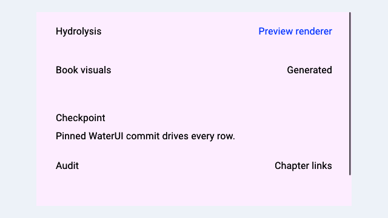

# Lists and collections

> **In this chapter, you will:**
> - Render an identity-keyed collection lazily with `List::for_each` and `#[derive(Identifiable)]`
> - Compose static, heterogeneous, sectioned lists with `List::content`, `Section`, `row` and `detail_row`
> - Select rows with `.selection(...)` and `.multi_selection(...)`, delete and reorder them in edit mode
> - Jump to any row programmatically with a `ScrollController<usize>`
> - Pick between `List`, `Lazy`, `Table` and `Accordion`

A collection grows and shrinks at runtime, so it cannot be written as a fixed tuple of views. WaterUI splits the job in two: `List::for_each` renders an identity-keyed collection lazily, and `List::content` composes a known set of rows with section chrome. Both produce one list view, which each backend realizes with its platform's look (a native table view on Apple platforms, a self-drawn list under Hydrolysis); how a list looks (grouped, inset, sidebar) is the backend's and the theme's decision, not a type you pick in view code. See [the styling chapter](11-styling.md).



*A Hydrolysis preview of sectioned WaterUI lists. [Example source](https://github.com/water-rs/book/tree/main/examples/book-visuals).*

## A first dynamic list

`List::for_each` takes a collection and a generator returning one `ListItem` per element. `List` and `ListItem` are in the prelude. The `Identifiable` trait is not, and the derive's expansion names the trait, so import `waterui::Identifiable`, which brings in both the trait and the derive.

```rust
use waterui::Identifiable;
use waterui::prelude::*;
use waterui::reactive::collection::List as ReactiveList;

#[derive(Clone, PartialEq, Identifiable)]
struct Todo {
    #[id]
    id: u32,
    title: Str,
    done: bool,
}

fn todo_list() -> impl View {
    let todos = ReactiveList::from(vec![
        Todo { id: 1, title: "Buy milk".into(), done: false },
        Todo { id: 2, title: "Write docs".into(), done: true },
    ]);

    List::for_each(todos, |todo| {
        ListItem::new(hstack((
            text(todo.title),
            spacer(),
            text(if todo.done { "Done" } else { "Pending" }),
        )))
    })
}
```

The list is **lazy**: renderers request only the rows in the visible viewport, and that stays true after a programmatic jump into the middle of a hundred-thousand-row collection. The generator runs each time a row is realized, which happens again when a row scrolls back into view, so keep it cheap and push expensive work into a `Computed` or an async task.

A fixed set of items needs no reactive collection. An array (or a `&'static` slice) works directly and identifies each row by its index:

```rust
use waterui::prelude::*;

fn fruit() -> impl View {
    List::for_each(["Apple", "Banana", "Cherry"], |name| ListItem::new(text(name)))
}
```

> **Prefer arrays for fixed collections.** Reach for `vec!` only when the length
> is decided at runtime, when the collection needs mutation, or when an API
> requires a `Vec`. A `Vec<T>` is identified by its items' ids, so it needs
> `Identifiable` items.

## Identity

A reactive collection identifies each row by its item's id, so the framework can patch membership instead of rebuilding every row. The derive marks exactly one field with `#[id]`:

```rust
use waterui::Identifiable;

#[derive(Clone, Identifiable)]
struct Contact {
    #[id]
    id: u64,
    name: String,
}

#[derive(Clone, Copy, Identifiable)]
struct ContactId(#[id] u64);
```

Structs only, with named or tuple fields. Exactly one field carries `#[id]`; the generated `id()` clones that field, so its type must be `Ord + Clone`.

> **Warning:** Identity must be **stable**. Changing an item's id makes the
> framework treat it as a removal followed by an insertion, discarding that
> row's view state instead of updating it in place.

## Reactive collections

A plain array or `Vec` describes data that never changes. For data that does, use `waterui::reactive::collection::List`: every mutation emits a fine-grained membership patch, and the rendered rows follow by id.

```rust
use waterui::Identifiable;
use waterui::reactive::collection::List as ReactiveList;

#[derive(Clone, PartialEq, Identifiable)]
struct Todo {
    #[id]
    id: u32,
    title: String,
}

fn seed() {
    // Bulk-seed in one move rather than a push loop.
    let mut items = ReactiveList::from(vec![Todo { id: 1, title: "Buy milk".into() }]);

    items.push(Todo { id: 2, title: "Write docs".into() });
    items.insert(0, Todo { id: 3, title: "Urgent".into() });
    let _removed = items.remove(0);

    // One diffed update instead of N individual mutations; returns the old contents.
    let _old = items.replace(vec![Todo { id: 4, title: "Ship it".into() }]);
}
```

The mutators take `&mut self` and clones share one list, so a handler mutates its own clone. `snapshot()` reads the contents as a `Vec` without subscribing; `replace` diffs by id, which is why the items implement `PartialEq`: a surviving id whose item compares unequal is reported as an updated row.

> **Note:** The rendering surface and the data structure are both called
> `List`. This chapter aliases the data type as `ReactiveList` and keeps the
> bare `List` for the view.

Never watch a signal that holds a `Vec` and rebuild a stack from it. `watch` replaces the entire watched subtree and discards its state on every change. For a derived row set (filtered, sorted), wrap the signal in `waterui::reactive::collection::SignalCollection` and hand that to `List::for_each`; see [the reactive chapter](../02-core/02-reactive.md).

## Sectioned and heterogeneous lists

`List::for_each` is homogeneous and section-free by design. When rows carry section headers, or the rows are a fixed heterogeneous set, use `List::content` with `Section`:

```rust
use waterui::prelude::*;

fn settings(status: &Binding<Str>, endpoint: &Binding<Str>) -> impl View {
    List::content((
        Section::new("Connection").content((
            row("Status", status.clone()),
            row("Endpoint", endpoint.clone()),
        )),
        Section::new("Activity")
            .footer("Updated every poll")
            .content((
                row("Polls", "128"),
                detail_row("Last error", "connection reset by peer"),
            )),
    ))
}
```

`ListContent` is a closed trait. It is implemented for `Row`, static row builders (`|| ListItem::new(...)`), either of those tagged with `.tag(value)`, a `ForEach` over a collection, `Section<C>`, tuples up to 15 elements, arrays, `Vec<T>`, `Option<T>` and `()`. Nothing else can leak into a list by accident.

Two details matter:

- A static row is a **builder**, not a finished `ListItem`: write `|| ListItem::new(...)`. The list rebuilds a row whenever it realizes it again.
- Sections are flat. A `Section` is content of the list but not of another section, so nesting one inside another does not compile.

```rust
use waterui::prelude::*;
use waterui::views::ForEach;
use waterui::reactive::collection::List as ReactiveList;
use waterui::Identifiable;

#[derive(Clone, PartialEq, Identifiable)]
struct Entry {
    #[id]
    id: u32,
    title: Str,
}

fn journal(today: ReactiveList<Entry>) -> impl View {
    List::content((
        Section::new("Today").content(ForEach::new(today, |entry: Entry| {
            ListItem::new(text(entry.title))
        })),
        Section::unlabeled().content(|| ListItem::new(text("That is everything"))),
    ))
}
```

A section's content can mix static rows and a `ForEach`. Rows are inserted and removed in place as the collection changes, the header sits on whichever row currently opens the section, and a section with no rows draws neither header nor footer until rows return.

### Rows

`row(label, value)` builds a single-line `label ……… value` row; `detail_row(label, value)` stacks the value under the label at full width. Both return a `Row`, which is valid list content directly and has `.detail()`, `.inline()`, `.value_color(color)`, `.deletable(bool)` and `.tag(value)`. Labels go through `IntoLabel` and values through `IntoText`, so a string literal in either position is localized, a `Binding<Str>` value updates in place, and both appear in the accessibility tree.

`Section::new(header)` labels a group, `Section::unlabeled()` produces group chrome with no header, and `.footer(text)` adds a caption below it. Header and footer are semantic text, so a string literal localizes and a signal-backed title updates in place.

### Row height and insets

`ListItem` carries per-row refinements: `.deletable(signal)` and `.insets(EdgeInsets)` (`EdgeInsets` is in the prelude), which replaces the theme's row insets for that row only. The floor every row is measured against comes from `ViewExt::list_min_row_height(points)`, which applies to every list below it; `0.0` sizes each row to its content plus its insets.

```rust
use waterui::prelude::*;

fn log() -> impl View {
    List::content((
        || ListItem::new(text("Alice joined the group")).insets(EdgeInsets::all(4.0)),
        || ListItem::new(text("Hello")),
    ))
    .list_min_row_height(0.0)
}
```

## Selection

Selection lives on the list and holds your own values, not row indexes. `.selection(&Binding<Option<T>>)` selects one row, `.multi_selection(&Binding<BTreeSet<T>>)` a set; `T` is `Ord + Clone`. The framework and backends write the binding on pointer, keyboard and accessibility input, and a later call replaces an earlier one.

What a row is selected *by* depends on how it was built:

- A `ForEach` row, including every row of `List::for_each`, is selected by its collection id (the index for an array or static slice).
- A static row of `List::content` is selected by the value it is tagged with, like SwiftUI's `.tag(_:)`. An untagged static row is not selectable.

```rust
use waterui::prelude::*;

#[derive(Clone, Copy, PartialEq, Eq, PartialOrd, Ord)]
enum Mailbox {
    Inbox,
    Archive,
}

fn mailboxes() -> impl View {
    let selection = binding(Some(Mailbox::Inbox));

    List::content(Section::new("Mailboxes").content((
        (|| ListItem::new(text("Inbox"))).tag(Mailbox::Inbox),
        row("Archive", "12").tag(Mailbox::Archive),
        row("Storage", "3 GB"),
    )))
    .selection(&selection)
}
```

Every selectable row of one list is selected by the same type; a selection of another type does not compile, and neither does a selection over `List::content` whose rows are all untagged. A row whose content is under `.disabled(true)` is inert to selection: input routes around it and the binding stays unchanged.

## Editing: delete and reorder

`editing`, `on_delete` and `on_move` turn a list into an editable one. The handlers receive `ListDelete` and `ListMove` as extractor parameters, next to any state you inject with `.state(...)`. Neither type is in the prelude.

```rust
use waterui::Identifiable;
use waterui::component::list::{ListDelete, ListMove};
use waterui::prelude::*;
use waterui::reactive::collection::List as ReactiveList;

#[derive(Clone, PartialEq, Identifiable)]
struct Contact {
    #[id]
    id: i32,
}

fn editable(contacts: ReactiveList<Contact>, editing: &Binding<bool>) -> impl View {
    List::for_each(contacts.clone(), |contact| {
        ListItem::new(text(contact.id.to_string()))
    })
    .editing(editing.clone())
    .on_delete(
        |State(mut contacts): State<ReactiveList<Contact>>, ListDelete(index): ListDelete| {
            let _ = contacts.remove(index);
        },
    )
    .on_move(
        |State(mut contacts): State<ReactiveList<Contact>>, ListMove(movement): ListMove| {
            let mut all = contacts.snapshot();
            let moved = all.remove(movement.from());
            all.insert(movement.to(), moved);
            let _ = contacts.replace(all);
        },
    )
    .state(&contacts)
}
```

`editing` takes any `bool` signal; while it is `true` the list shows delete buttons and drag handles, so pass the binding an Edit button toggles. `ListDelete(index)` destructures to a `usize`; `ListMove(movement)` carries a `Move` with `.from()` and `.to()`. Per-row refinement goes on the item: `ListItem::new(view).deletable(false)` (or `Row::deletable(false)`) opts a single row out of deletion. Handlers with an owned `#[state]` type take it bare; `State<T>` wraps values of foreign types such as `ReactiveList` and `Binding`. See [the reactive chapter](../02-core/02-reactive.md).

## Programmatic scrolling

A `ScrollController<usize>` targets **item indices** and pairs with `List`; a `ScrollController<Point>` targets **coordinates** and pairs with `scroll(...)`. Both are plain values you own and can hold anywhere. `scroll_to` jumps; `animate_to(target, animation)` glides, and an animated list request further than 100 rows away jumps to within 100 rows of the target first and animates only the final stretch.

```rust
use waterui::Identifiable;
use waterui::animation::Animation;
use waterui::prelude::*;
use waterui::reactive::collection::List as ReactiveList;

#[derive(Clone, PartialEq, Identifiable)]
struct Entry {
    #[id]
    id: usize,
}

fn jump_list() -> impl View {
    let entries = ReactiveList::from((0..100_000).map(|id| Entry { id }).collect::<Vec<_>>());
    let scroll_to = ScrollController::<usize>::new(0);

    vstack((
        hstack((
            button("Jump to 50,000").action({
                let scroll_to = scroll_to.clone();
                move || scroll_to.scroll_to(50_000)
            }),
            button("Glide to top").action({
                let scroll_to = scroll_to.clone();
                move || scroll_to.animate_to(0, Animation::default())
            }),
        )),
        List::for_each(entries, |entry| ListItem::new(text(entry.id.to_string())))
            .scroll_controller(&scroll_to),
    ))
}
```

Because the list is lazy, a jump of fifty thousand rows realizes only the rows that land in the viewport. The controller tracks a generation alongside the target, so requesting the same index twice still scrolls after the user has moved away.

For coordinate scrolling, hand a `ScrollController<Point>` to a scroll view and keep a clone wherever the request comes from:

```rust
use waterui::prelude::*;

fn scrolled_content(body: impl View) -> impl View {
    let viewport = ScrollController::new(Point::zero());

    vstack((
        button("Back to top").action({
            let viewport = viewport.clone();
            move || viewport.scroll_to(Point::zero())
        }),
        scroll(body).scroll_controller(&viewport),
    ))
}
```

## Lazy stacks without list chrome

`List` gives you list chrome: row metrics, selection, editing, sections. When you want a lazy scrolling stack with none of it, `Lazy` wraps a lazy container in a scroll view. `Lazy::for_each(collection, generator)` takes the same collections as `List::for_each`, but its generator returns any view rather than a `ListItem`. `Lazy::vstack` and `Lazy::hstack` take a ready-made `Views` collection, such as an array or `Vec` of views or a `ForEach`; `Lazy::vstack_spaced(spacing, ...)` and `Lazy::hstack_spaced(spacing, ...)` add a gap between items.

```rust
use waterui::component::lazy::Lazy;
use waterui::prelude::*;

fn gallery() -> impl View {
    Lazy::for_each(["First", "Second", "Third"], |caption| text(caption))
}

fn big_stack() -> impl View {
    Lazy::vstack_spaced(8.0, (0..1000).map(|i| text!("Item {i}")).collect::<Vec<_>>())
}
```

A small, static set of views does not need virtualization; a plain `vstack` lays out every item at once.

## Tables

`Table` shows data in columns of text. It is built from `TableColumn`s, each a label plus a `Views` collection of `Text` rows; `col(label, rows)` is the short constructor. Neither is in the prelude, so import both from `waterui::component::table`.

```rust
use waterui::component::table::{Table, col};
use waterui::prelude::*;

fn roster() -> impl View {
    Table::new(vec![
        col("Name", [text("Ada"), text("Grace"), text("Margaret")]),
        col("Role", [text("Engineer"), text("Admiral"), text("Lead")]),
    ])
}
```

Rows are matched across columns by position, and the table is as tall as its longest column. A column built from a reactive `Views` collection updates its rows in place. The Apple and Hydrolysis backends realize `Table` themselves; a backend that does not gets the default realization, a bold header, a divider and the rows through a `List`.

## Accordion

`accordion(header, content)` is a header that expands to reveal content. The content closure runs lazily when the accordion opens, and its state may not survive a collapse. `Accordion::with_toggle(&binding, header, content)` lets you control the expanded state from outside. Both live in `waterui::widget`, outside the prelude.

```rust
use waterui::prelude::*;
use waterui::widget::accordion;

fn advanced() -> impl View {
    accordion("Advanced options", || text("Only built once expanded"))
}
```

## Choosing between the surfaces

| You have | Use |
|---|---|
| An identity-keyed collection that changes at runtime | `List::for_each` over a `ReactiveList` |
| A fixed set of rows with headers, footers, mixed shapes or selection | `List::content` with `Section` / `row` |
| A large collection with no list chrome | `Lazy::for_each` |
| Rows of plain text in aligned columns | `Table` |
| One block of content the reader opens on demand | `accordion` |
| A handful of views that never change | `vstack` |

Lists show data. Showing *different* views depending on a condition, such as a spinner while data loads or a login prompt when the user is signed out, is the [next chapter](06-conditional.md).
