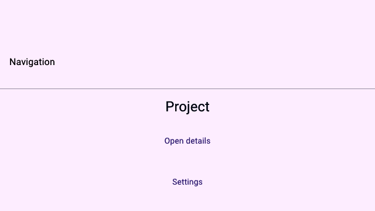

# Navigation

> **In this chapter, you will:**
> - Push screens with `NavigationStack`, `NavigationView`, and `NavigationLink`
> - Model screens as route data with `NavigationPath`, `.destination(...)`, and `Navigator`
> - Declare bar chrome (titles, toolbars, search) and destination lifecycle hooks
> - Choose a transition, including a matched zoom and a custom one
> - Build top-level structure with `Tabs` and `NavigationSplitView`, and open deep links with `NavigationRouter`

WaterUI keeps navigation state in Rust and projects it into the platform's own container. The Apple backend drives UIKit and AppKit navigation, tab and split controllers; Hydrolysis, which also realizes Android, Linux and Windows, draws retained pages itself. Your route list is the source of truth. Every change reaches the backend as one atomic transaction describing a retained prefix, a number of removals, and the destinations to insert, so the platform stack cannot drift out of sync with your state.

Bars, tab strips, sidebars and search fields are never views you compose out of stacks. You declare what they are; each backend realizes them with its platform's look. If a bar looks wrong on one platform, that is a backend defect, not something to imitate with an `hstack`.



*A Hydrolysis preview of WaterUI navigation chrome and links. [Example source](https://github.com/water-rs/book/tree/main/examples/book-visuals).*

## The smallest stack

```rust
use waterui::prelude::*;

fn app() -> impl View {
    NavigationStack::new(NavigationView::new(
        "Library",
        NavigationLink::new("Open settings", || {
            NavigationView::new("Settings", text("Preferences"))
        }),
    ))
}
```

`NavigationStack::new` accepts a `NavigationView`, not an arbitrary view, because the root is a destination with its own bar. `NavigationLink::new` pairs a label (anything that is `IntoLabel`) with a builder closure returning the destination; the closure runs only when the link is activated, so screens the user never opens cost nothing.

> **Note:** `NavigationLink` needs a surrounding navigation context. A debug
> assertion fires if you place one outside a `NavigationStack`.

## Navigation views and titles

Any view becomes a destination through `.title(...)`, which is `NavigationView::new(title, content)` with the content first:

```rust
use waterui::prelude::*;

fn detail(name: &'static str) -> NavigationView {
    vstack((text(name), text("Some detail content")))
        .title("Detail")
        .navigation_subtitle("Updated just now")
        .inline_title()
}
```

`NavigationView` is the type every destination closure must return, so a helper that builds a screen returns `NavigationView`, not `impl View`.

The title display mode controls how the bar renders the title:

| Method / mode                                      | Behavior                                              |
|----------------------------------------------------|-------------------------------------------------------|
| `NavigationTitleDisplayMode::Automatic` (default)  | The platform decides: large on a root, inline when pushed |
| `.inline_title()`                                  | A small inline title                                  |
| `NavigationTitleDisplayMode::Medium`               | Between inline and large (Material's medium app bar)  |
| `.large_title()`                                   | A large title that collapses on scroll                |

Set a mode held in a variable with `.navigation_title_display_mode(mode)`. Automatic already follows platform convention, so reach for the overrides only when your design departs from it.

> **Watch out:** `Text` has its own inherent `.title()` with no arguments. That
> is the typography preset from the [text chapter](01-text.md), not a
> navigation title. On a bare `Text`, write `NavigationView::new("Title", text(...))`
> instead of `text(...).title("Title")`.

## Routes as data

Builder-closure links are fine for a one-off drill-down. Anything that needs deep links, "back to root", or restoring where the user was should model destinations as values held by a `NavigationPath<Route>`:

```rust
use waterui::prelude::*;

#[derive(Clone, PartialEq, Eq)]
enum Route {
    Article(u64),
    Settings,
}

fn app() -> impl View {
    let path = NavigationPath::<Route>::new();

    NavigationStack::with_path(
        path,
        NavigationView::new(
            "Library",
            vstack((
                NavigationLink::value("Read article 42", Route::Article(42)),
                NavigationLink::value("Open settings", Route::Settings),
            )),
        ),
    )
    .destination(|route| match route {
        Route::Article(id) => NavigationView::new("Article", text!("Article {id}")),
        Route::Settings => NavigationView::new("Settings", text("Preferences")),
    })
}
```

A route type must be `Clone + PartialEq + 'static`. `PartialEq` lets the stack compute the longest retained prefix between the old and new path, so pushing one route builds one screen instead of rebuilding the whole stack. The `destination` closure is total over your enum, so the compiler tells you when a new variant has no screen.

`NavigationLink::value` finds the stack's `Navigator` in the environment and pushes the value when activated. Rendering one outside a path-backed stack of the same route type panics.

`NavigationPath` is itself a shared reactive value. Clone it to hand the same path to another part of your app; do not wrap it in a `Binding`. To start deeper than the root, build it from a `Vec`:

```rust
use waterui::prelude::*;

#[derive(Clone, PartialEq, Eq)]
enum Route {
    Article(u64),
    Settings,
}

fn resumed_path() -> NavigationPath<Route> {
    NavigationPath::from(vec![Route::Settings, Route::Article(7)])
}
```

Links built with `NavigationLink::new` and path-driven routes can share one stack. A screen pushed by a builder link is owned by the stack's controller alone; it pops without touching your route state and is discarded if the path beneath it changes.

## Driving the path

Mutate the path directly, or extract a `Navigator<Route>` inside any handler:

```rust
use waterui::prelude::*;

#[derive(Clone, PartialEq, Eq)]
enum Route {
    Article(u64),
    Settings,
}

fn controls() -> impl View {
    vstack((
        button("Settings").action(|navigator: Navigator<Route>| {
            navigator.push(Route::Settings);
        }),
        button("Back").action(|navigator: Navigator<Route>| {
            navigator.pop();
        }),
        button("Home").action(|navigator: Navigator<Route>| navigator.pop_to_root()),
        button("Jump").action(|navigator: Navigator<Route>| {
            navigator.replace([Route::Settings, Route::Article(7)]);
        }),
    ))
}
```

`pop` returns `Option<Route>`, the route that was removed, or `None` at the root. `replace` is not a loop of pushes and pops: it diffs against the current path and emits a single transaction, so you get one animation instead of a stutter of them.

The same operations exist on `NavigationPath` itself (`push`, `pop`, `pop_n`, `truncate`, `clear`, `replace`, plus `len`, `is_empty`, `snapshot` and `iter`) for code that holds the path outside a view handler.

To pop whatever is on top, including a screen pushed by a `NavigationLink::new`, extract the `NavigationController`:

```rust
use waterui::prelude::*;

fn back_button() -> impl View {
    button("Back").action(|controller: NavigationController| controller.pop())
}
```

## Native back gestures

The back swipe, the back button and the system back action originate in the platform, not in your Rust code. The backend routes them through the navigation controller, which writes the pop into your `NavigationPath`, so after any native back the path still describes what is on screen. There is no second, hidden copy of the stack to reconcile.

That gives you a place to intervene. A destination can refuse to be popped and can observe the attempt either way:

```rust
use waterui::prelude::*;

fn checkout(has_unsaved_changes: Computed<bool>) -> NavigationView {
    let can_leave = has_unsaved_changes.map(|dirty| !dirty);

    NavigationView::new("Checkout", text("Review your order"))
        .navigation_pop_enabled(can_leave)
        .on_navigation_pop_attempted(|| waterui::log::debug!("user tried to leave checkout"))
}
```

## Destination lifecycle

Four hooks fire on a `NavigationView`. Each takes a handler, so it can extract state like `.action` does.

| Hook                              | Fires when                                                           |
|-----------------------------------|----------------------------------------------------------------------|
| `.on_navigation_appear(h)`        | The transition that makes the destination active has completed       |
| `.on_navigation_disappear(h)`     | The transition away has completed, including when a screen is pushed above |
| `.on_navigation_pop_attempted(h)` | A user or system pop is requested, even if it is then denied         |
| `.on_navigation_pop(h)`           | A pop completed and removed this destination                         |

Use `disappear` to pause work such as a video or a poll, and `pop` for teardown that must not run when the screen is merely covered:

```rust
use waterui::prelude::*;

fn editor() -> NavigationView {
    NavigationView::new("Editor", text("Draft"))
        .on_navigation_appear(|| waterui::log::debug!("editor active"))
        .on_navigation_disappear(|| waterui::log::debug!("editor covered or left"))
        .on_navigation_pop(|| waterui::log::debug!("editor closed for good"))
}
```

These fire when a navigation transition completes. The general view modifiers for mounting and unmounting are a different thing; use the navigation hooks for "this page was opened" logic.

## Toolbars, bar chrome, and search

Toolbar content is declared by semantic placement rather than by position. You say what an item means; the backend decides where it goes. Cancellation and confirmation actions land where each platform puts them, and `BottomBar` and `Status` move to a bottom toolbar. You write the item once.

```rust
use waterui::prelude::*;

fn compose() -> NavigationView {
    NavigationView::new("New message", text("Message body"))
        .navigation_toolbar(NavigationToolbar::new(vec![
            NavigationToolbarItem::action(
                NavigationToolbarPlacement::Cancellation,
                "Cancel",
                || waterui::log::debug!("cancelled"),
            ),
            NavigationToolbarItem::action(
                NavigationToolbarPlacement::Confirmation,
                "Save",
                || waterui::log::debug!("saved"),
            ),
        ]))
}
```

The placements are `Principal`, `PrimaryAction`, `SecondaryAction`, `Confirmation`, `Cancellation`, `BottomBar`, `Status`, `TopBarLeading` and `TopBarTrailing`. Pick by meaning: a secondary action belongs in `SecondaryAction`, not hard-coded into `TopBarTrailing`.

`NavigationToolbarItem::action(placement, label, handler)` takes an `IntoLabel`, keeps the label's name and icon apart, and lets each platform draw what its chrome calls for (a Mac toolbar usually shows the icon alone and keeps the name for the tooltip and assistive technology). Give it `label("Compose").icon(...)` to carry an icon; see [the icons chapter](12-icons.md). `NavigationToolbarItem::new(placement, view)` takes arbitrary content instead, and `NavigationToolbar::default().item(...)` appends items one at a time.

Three more bar modifiers take signals, so the bar updates without rebuilding the screen:

```rust
use waterui::prelude::*;

fn browser(immersive: Computed<bool>) -> NavigationView {
    let query: Binding<Str> = binding("");

    NavigationView::new("Browse", text("Results"))
        .searchable(&query, "Search the library")
        .navigation_bar_visibility(immersive.map(|immersive| !immersive))
        .navigation_bar_color(Color::new(theme_color::SurfaceVariant))
}
```

`searchable` puts a search field in the bar chrome and writes the typed text into your `Binding<Str>`, so filtering is an ordinary derived signal over that binding. `navigation_bar_visibility` takes visible, not hidden. Leave `navigation_bar_color` off unless you deliberately want to override the platform material; without it each backend uses the surrounding `Surface` theme token and its own treatment.

Window-level toolbars and window chrome are not part of a navigation destination; they are covered in [the windows chapter](08-windows.md).

## Transitions

A stack's transition is set once, on the stack, and applies to every page:

```rust
use waterui::prelude::*;

#[derive(Clone, PartialEq, Eq)]
enum Route {
    Settings,
}

fn faded(path: NavigationPath<Route>, root: NavigationView) -> impl View {
    NavigationStack::with_path(path, root)
        .destination(|_| NavigationView::new("Settings", text("Preferences")))
        .transition(navigation_transition::fade())
}
```

`navigation_transition` provides `automatic()` (the default platform push and pop), `fade()`, `none()` and `zoom(id)`. A destination can override the stack with `NavigationView::transition(...)`, and a `.transition(...)` on the destination's content root takes precedence over both. A destination declares one of those two, not both.

The backends do not realize every transition yet. Hydrolysis plays all of them, including the matched zoom and a custom one. The Apple backend plays UIKit's standard push and pop on iOS for anything other than `none()`. On macOS it cross-fades for `fade()` and switches pages without animation for everything else.

A zoom is a matched-geometry transition, so both ends carry the same `Id`. The pair differs per destination (tile 3 and the page it opens share an identity that tile 4 does not), so the transition belongs on the destination:

```rust
use waterui::id::Id;
use waterui::prelude::*;

#[derive(Clone, PartialEq, Eq)]
struct Photo(i32);

fn photo_id(photo: &Photo) -> Id {
    Id::try_from(photo.0 + 1).expect("photo ids start at zero, so id + 1 is non-zero")
}

fn tile(photo: Photo) -> impl View {
    let id = photo_id(&photo);
    NavigationLink::value("Open photo", photo).navigation_transition_source(id)
}

fn photo_page(photo: Photo) -> NavigationView {
    let id = photo_id(&photo);
    NavigationView::new(
        "Photo",
        text("Full size").navigation_transition_destination(id),
    )
    .transition(navigation_transition::zoom(id))
}
```

`Id` is non-zero and fallible: there is no `Id::new`, and `0` is rejected, which is why a zero-based index gets `+ 1`. Both halves must be on screen when the transition runs. On Hydrolysis a zoom whose source or destination is missing panics. A page that can also open without its tile underneath, from a deep link for example, should not declare the zoom.

`NavigationTransition` is a trait, not a closed enum. Implement `frame(progress, direction)` to describe the outgoing and incoming page at each step, as offsets in viewport fractions, a scale and an opacity:

```rust
use waterui::prelude::*;

#[derive(Debug)]
struct Rise;

impl NavigationTransition for Rise {
    fn frame(
        &self,
        progress: f32,
        direction: NavigationTransitionDirection,
    ) -> NavigationTransitionFrame {
        match direction {
            NavigationTransitionDirection::Push => NavigationTransitionFrame::new(
                NavigationTransitionLayer::IDENTITY,
                NavigationTransitionLayer::new(0.0, 1.0 - progress, 1.0, 1.0),
            ),
            NavigationTransitionDirection::Pop => NavigationTransitionFrame::new(
                NavigationTransitionLayer::new(0.0, progress, 1.0, 1.0),
                NavigationTransitionLayer::IDENTITY,
            ),
        }
    }
}
```

Hydrolysis samples your `frame` at every step, with `progress` in `0.0..=1.0`. `outgoing` is always the page that was active, so on `Pop` it is the destination being removed. A custom transition has no native projection, so the Apple backend never calls `frame` and plays the standard motion described above instead.

## Tabs

`Tabs` takes a caller-owned selection binding and a collection of `Tab`s. A `Vec` is a fixed set keyed by index, so the selection is a `Binding<usize>`. A set that changes at runtime is a `ForEach` over a reactive list (see [the lists chapter](05-lists.md)), keyed by the id of each element.

```rust
use waterui::prelude::*;

fn root(unread: Computed<i32>) -> impl View {
    let selection: Binding<usize> = binding(0usize);

    Tabs::new(
        &selection,
        vec![
            Tab::container("Inbox", || {
                NavigationStack::new(NavigationView::new("Inbox", text("No messages")))
            })
            .badge(unread),
            Tab::container("Settings", || {
                NavigationStack::new(NavigationView::new("Settings", text("Preferences")))
            }),
            Tab::container("Search", || {
                NavigationStack::new(NavigationView::new("Search", text("Type to search")))
            })
            .role(TabRole::Search),
        ],
    )
    .style(tab_style::automatic())
    .minimize_behavior(TabBarMinimizeBehavior::OnScrollDown)
}
```

Use `Tab::container` whenever a tab has pushable content. The content is a navigation container (a `NavigationStack` or a `NavigationSplitView`) that contributes its own bar, so each tab keeps its own history: push twice in Inbox, visit Settings, come back, and both pages are still there. `Tab::new(label, || NavigationView::...)` is the plain form, whose builder returns a single `NavigationView`.

`selection` is read to know which tab is active and written to switch tabs from anywhere. `.badge(signal)` and `.enabled(signal)` take signals, so a count or a lock state updates in place.

Presentation is an attribute, not a different type. `tab_style::automatic()` lets the platform and window size choose between a tab bar, a sidebar and a navigation rail; `tab_style::tab_bar()` and `tab_style::sidebar()` request one explicitly.

Two more attributes are platform conventions. `TabRole::Search` marks the tab the platform presents as search (on iOS the system's trailing search tab; elsewhere a regular tab). `TabBarMinimizeBehavior` (`Automatic`, `Never`, `OnScrollDown`, `OnScrollUp`) lets iOS 26 collapse the tab bar while content scrolls; platforms whose tab chrome does not collapse ignore it. `.bottom_accessory(view)` sets a view iOS 26 floats above the tab bar, such as a mini-player; macOS does not show it and Android ignores it.

## Split view

`NavigationSplitView` is the two- or three-column layout behind mail clients and settings apps. You own the selection binding, a `Binding<Option<T>>` over your own selection type, and the detail column is built from the unwrapped value.

```rust
use waterui::prelude::*;

fn mailbox(
    selection: Binding<Option<u64>>,
    visibility: Binding<NavigationSplitColumnVisibility>,
) -> impl View {
    let sidebar_selection = selection.clone();

    NavigationSplitView::new(
        &selection,
        move || {
            let selection = sidebar_selection.clone();
            button("Select message 7").action(move || selection.set(Some(7)))
        },
        |id| NavigationView::new("Message", text!("Message {id}")),
    )
    .placeholder(text("Select a message"))
    .sidebar_width(ColumnWidth::new(240.0, 320.0, 480.0))
    .column_visibility(visibility)
    .style(split_style::prominent_detail())
}
```

At compact widths exactly one column is visible: the detail while the selection is `Some`, the sidebar while it is `None`, and the platform back control writes `None`. Start with `None` to open on the sidebar. You do not branch on screen size.

`ColumnWidth::new(min, ideal, max)` gives the platform real resize constraints and panics unless all three are finite and `0 < min <= ideal <= max`; the default is `240`, `320`, `480`. `column_visibility` takes a signal over `Automatic`, `All`, `DoubleColumn` or `DetailOnly`, and a plain value works too, so a "hide the sidebar" button is a write to a binding rather than a rebuild. `split_style` offers `automatic()`, `balanced()` and `prominent_detail()`. For independent sidebar and content selections, use `NavigationSplitView::three_column(&sidebar_selection, &content_selection, sidebar, content, detail)`.

The sidebar is usually a selectable list; see [the lists chapter](05-lists.md).

## Deep links

`NavigationRouter` turns an incoming URL into a complete path in one atomic replacement:

```rust
use waterui::prelude::*;
use waterui::Url;

#[derive(Clone, PartialEq, Eq)]
enum Route {
    Article(u64),
    Settings,
}

fn open_deep_link(path: &NavigationPath<Route>, url: &Url) -> bool {
    let router = NavigationRouter::new(path.clone())
        .route(|url| (url.path() == "/settings").then_some(vec![Route::Settings]));

    router.open(url)
}
```

A resolver returns `None` for a URL it does not own and the full route sequence for one it does. `open` returns `false` when no resolver claims the URL, and panics if two resolvers claim the same one: ambiguous routing is a bug, not something to settle by precedence. URL syntax is yours; it is deliberately separate from how a path is serialized.

## Restoration

Enable the `navigation-restoration` feature on `waterui` and a typed `NavigationPath<Route>` serializes through ordinary serde, so you can persist where the user was and restore it on the next launch. Your route type derives `serde::Serialize` and `serde::Deserialize`; your app declares the `serde` and `serde_json` dependencies it uses.

```rust,ignore
let encoded = serde_json::to_string(&path)?;
let restored: NavigationPath<Route> = serde_json::from_str(&encoded)?;
```

Hand the restored path to `NavigationStack::with_path` at launch. The stack projects all of its routes into the platform stack in one transaction, and the Rust path stays the source of truth from then on. Your app decides where and when the encoded state is stored.

## Where to go next

Screens live inside windows. [The windows chapter](08-windows.md) covers declaring windows, their chrome and toolbars, and the app lifecycle around them.
