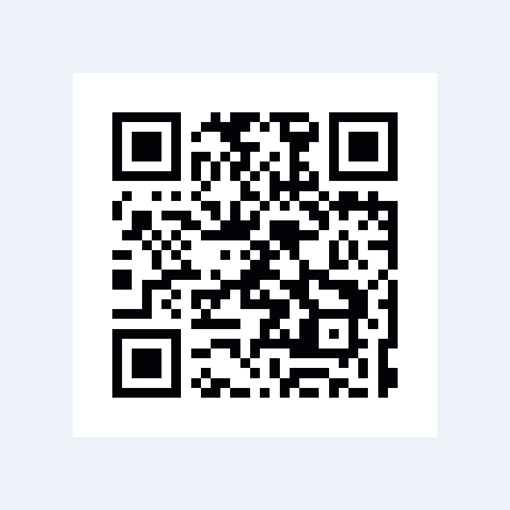
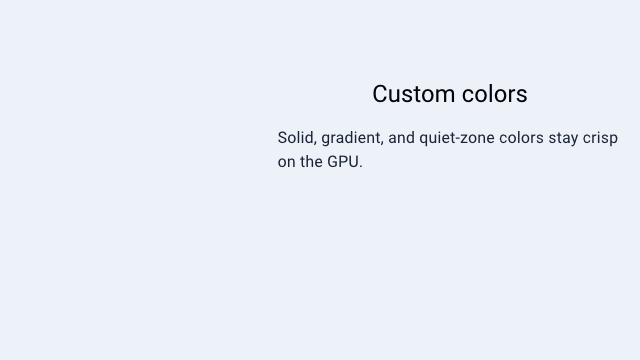

# Barcodes and QR codes

> **In this chapter, you will:**
> - Render QR codes and Code 128 barcodes from a string or a live signal
> - Tint modules with solid colors, gradients, and reactive colors
> - Fill a code with an `Ink` through `fill_scene`
> - Validate untrusted input with `BarcodeSource` before it reaches a view

A barcode is data that must survive being photographed at a bad angle in bad
light. The component is built around that: it encodes the module matrix once,
draws the dark modules as vector geometry on a [`Canvas`](../05-graphics/01-canvas.md),
and leaves resolution and anti-aliasing to whichever renderer draws the screen
around it, so a code stays crisp at any size.

Barcode is a split crate, [`water-rs/barcode`](https://github.com/water-rs/barcode),
that the facade re-exports. It requires the `barcode` feature on `waterui`
(`waterui = { version = "...", features = ["barcode"] }`) and appears as
`waterui::barcode`.



*A QR code rendered by the WaterUI barcode component. [Example source](https://github.com/water-rs/book/tree/main/examples/book-visuals).*

## Quick start

```rust
use waterui::barcode::Barcode;
use waterui::prelude::*;

fn share_link() -> impl View {
    Barcode::qr("https://book.waterui.dev").size(280.0, 280.0)
}

fn product_label() -> impl View {
    Barcode::code128("WATERUI-BOOK").size(250.0, 92.0)
}
```

`Barcode::qr` and `Barcode::code128` return a `Barcode`, which is a `View`.
The free functions `waterui::barcode::qr_code(content)` and
`waterui::barcode::code128(content)` call them. Content is any
`impl IntoComputed<Str>`: a `&'static str` literal, a `String`, a `Str`, or a
signal of any of them. A borrowed `&str` that is not `'static` does not
convert; pass an owned `String` or `Str` instead.

### Give the code a size

A barcode reports a natural size to layout, computed from the encoded symbol:
256 points on each side by default, grown where needed so that every module,
quiet zone included, is at least one point wide. A Code 128 symbol is 256
points tall and at least as wide as its modules. When the container proposes
neither axis, the barcode takes that natural size. When it proposes one axis,
the other follows the natural aspect ratio, and when it proposes both, the
barcode fills that box. A barcode never takes leftover space in a stack. Pin
an exact box with `.size(width, height)` from
[the modifiers chapter](../02-core/04-modifiers.md).

A QR code keeps square modules: inside a non-square box it is centered in the
largest square that fits. A Code 128 symbol stretches to fill its box, so its
height is whatever you give it.

## Supported symbologies

| Symbology | Constructor | Shape | Typical use |
|---|---|---|---|
| QR Code | `Barcode::qr(content)` | 2D matrix | URLs, tokens, arbitrary text |
| Code 128 | `Barcode::code128(content)` | 1D bars | Alphanumeric product and asset codes |

`BarcodeSymbology` (`Qr`, `Code128`) is `#[non_exhaustive]`, so a `match`
against it needs a wildcard arm.

Code 128 content is encoded with character set B unless it starts with one of
the character-set markers `À` (set A), `Ɓ` (set B), or `Ć` (set C). The same
markers switch sets inside the content.

### Content can be a signal

Because content is a signal, a rotating token or a live pairing URL re-encodes
the matrix in place. The view is not rebuilt and the canvas closure does not run
again: the new module path reaches the retained drawing as a live operand. A
longer payload can grow the natural size, and the canvas reports that through
its intrinsic-size signal, so layout measures again.

```rust
use waterui::barcode::Barcode;
use waterui::prelude::*;

fn live_pairing_code() -> impl View {
    let session = Binding::container(1_u32);
    let url = session.map(|session| Str::from(format!("https://book.waterui.dev/pair/{session}")));

    vstack((
        Barcode::qr(url).size(260.0, 260.0),
        button("New code").action(move || session.with_mut(|session| *session += 1)),
    ))
    .spacing(12.0)
}
```

Here your code produces every payload, so it always fits. Text a user types
is different; check it first, as the next section shows.

### Encoding failures

Encoding runs while the view renders. Content the encoder rejects, such as a
payload beyond QR capacity or characters outside Code 128's set, panics with
the encoder's error instead of drawing an empty code. That is the right
behavior for a literal you wrote, and the wrong one for text a user typed.
Validate untrusted input first with `BarcodeSource`, which returns a
`Result<BarcodeSource, BarcodeError>`:

```rust
use waterui::barcode::{Barcode, BarcodeSource};
use waterui::log::warn;
use waterui::prelude::*;

fn checked_qr(input: Str) -> AnyView {
    match BarcodeSource::qr(input.clone()) {
        Ok(_) => AnyView::new(Barcode::qr(input).size(220.0, 220.0)),
        Err(error) => {
            warn!(%error, "content does not fit a QR code");
            AnyView::new(text("This text is too long for a QR code"))
        }
    }
}
```

`BarcodeSource::qr` and `BarcodeSource::code128` take `impl Into<Str>`.
`BarcodeError` has two variants, `Qr` and `Code128`, and implements
`std::error::Error` and `Display`. The Code 128 variant also covers content
that is too short to encode.

## Coloring modules



*A Hydrolysis preview of custom colors and a gradient fill. [Example source](https://github.com/water-rs/book/tree/main/examples/book-visuals).*

Dark modules default to black; light modules and the quiet zone default to
white. `dark_color` and `light_color` override them:

```rust
use waterui::barcode::Barcode;
use waterui::prelude::*;

fn branded_qr() -> impl View {
    Barcode::qr("https://book.waterui.dev")
        .dark_color(Color::srgb(12, 26, 45))
        .light_color(Color::srgb(246, 250, 255))
        .size(280.0, 280.0)
}
```

Keep the contrast high. Scanners threshold the image, so a dark-on-dark palette
that looks tasteful on screen may not decode at all. Colors are the unresolved
`Color` type, so theme-aware colors resolve against the environment like any
other component.

### Gradient fill

`linear_gradient` replaces the solid dark fill with a two-stop gradient:

```rust
use waterui::barcode::Barcode;
use waterui::prelude::*;

fn gradient_qr() -> impl View {
    Barcode::qr("https://book.waterui.dev")
        .linear_gradient(
            Color::srgb(0, 108, 255),
            Color::srgb(255, 62, 122),
            UnitPoint::TOP_LEADING,
            UnitPoint::BOTTOM_TRAILING,
        )
        .size(280.0, 280.0)
}
```

The endpoints are `UnitPoint`s normalized to the area the symbol occupies,
quiet zone included, not to the whole surface. For a QR code that area is the
centered square, so `TOP_LEADING` is the symbol's top-left corner even when the
view is wider than the symbol; a Code 128 symbol fills its box, so there the
two coincide. Anything `Into<UnitPoint>` is accepted, and
`[0.0, 0.0]` is the same as `UnitPoint::TOP_LEADING`. Gradient colors
interpolate in encoded sRGB.

### Reactive colors

Every color argument is `impl IntoComputed<Color>`, so pass a `Binding` or a
`Computed` and the retained drawing updates in place, with no view rebuild and no
re-encoding:

```rust
use waterui::barcode::Barcode;
use waterui::prelude::*;

fn invertible_qr() -> impl View {
    let inverted = binding(false);
    let ink = Color::srgb(12, 26, 45);
    let paper = Color::srgb(255, 255, 255);

    vstack((
        Barcode::qr("https://book.waterui.dev")
            .dark_color(inverted.map({
                let (ink, paper) = (ink.clone(), paper.clone());
                move |inverted| if inverted { paper.clone() } else { ink.clone() }
            }))
            .light_color(inverted.map(move |inverted| {
                if inverted { ink.clone() } else { paper.clone() }
            }))
            .size(280.0, 280.0),
        toggle("Invert", &inverted),
    ))
    .spacing(16.0)
}
```

`SignalExt::map` borrows the binding, so the same `inverted` still drives the
`toggle`. See [the reactive chapter](../02-core/02-reactive.md) for the signal
model.

## Filling a code with an ink

`fill_scene` takes any `Ink` and uses it as the fill: the ink draws across the
whole box and is clipped to the dark modules, over the light color. A gradient,
an image, or an animated drawing becomes the barcode's fill without either side
knowing about the other.

`Ink` (`waterui::barcode::Ink`) is implemented for two things: a
`FnOnce(&mut Cx) + 'static` closure, which draws on the barcode's own canvas
with the `Cx` methods from [the canvas chapter](../05-graphics/01-canvas.md),
and a canvas `Drawing`, which is scaled to cover the barcode's box.

```rust
use waterui::barcode::Barcode;
use waterui::canvas::{Cx, LinearGradient, Paint};
use waterui::color::Srgb;
use waterui::layout::{Point, Rect, Size};
use waterui::prelude::*;

fn diagonal_ink(cx: &mut Cx) {
    let size = cx.size();
    let paint = size.map(|size: Size| -> Paint {
        LinearGradient::new(Point::new(0.0, 0.0), Point::new(size.width, size.height))
            .stop(0.0, Srgb::new(0.0, 0.42, 1.0))
            .stop(1.0, Srgb::new(1.0, 0.24, 0.48))
            .into()
    });
    cx.fill(size.map(Rect::from_size), paint);
}

fn artistic_qr() -> impl View {
    Barcode::qr("https://book.waterui.dev")
        .fill_scene(diagonal_ink)
        .light_color(Color::srgb(255, 255, 255))
        .size(280.0, 280.0)
}
```

A function that accepts any ink takes `impl Ink`:

```rust
use waterui::barcode::{Barcode, Ink};
use waterui::prelude::*;

fn inked_qr(ink: impl Ink) -> impl View {
    Barcode::qr("https://book.waterui.dev")
        .fill_scene(ink)
        .size(280.0, 280.0)
}
```

`fill_scene` returns a `BarcodeSceneFill<I>`. Its only method of its own is
`light_color`, since the dark modules now come from your ink; view modifiers
such as `.size` apply as on any view. The barcode keeps its own natural size,
whatever the ink would report.

## How it works

The crate encodes, builds geometry and draws on a canvas; the renderer
rasterizes:

1. **Matrix.** `fast_qr` encodes QR and `barcoders` encodes Code 128, once per
   payload, into a bit-packed `BarcodeMatrix` (`1` is dark). A Code 128 matrix
   has a single row, because bar height is a rendering concern.
2. **Geometry.** All dark modules become one filled path; horizontally adjacent
   modules merge into one rectangle, so the path grows with the bar count, not
   the module count.
3. **Drawing.** `Barcode` is a `Canvas` that fills the light background and
   then the dark path, with the path, the colors and the gradient endpoints
   bound as live operands. The canvas' intrinsic size follows the payload.
4. **Rasterization.** Whichever renderer draws the screen around the canvas
   rasterizes it, so a barcode needs no engine of its own.

`fill_scene` changes only the last fill: the canvas fills the light background,
then runs the ink inside a clip shaped like the dark modules.

### Quiet zones

| Symbology | Quiet zone |
|---|---|
| QR Code | 4 modules on every side |
| Code 128 | 10 modules left and right, none above or below |

The quiet zone is part of the symbol and painted in the light color. You do not
pad the view yourself.

### Accessibility

A barcode is exposed as an image whose label reads `QR code: <content>` or
`Code 128 barcode: <content>`, and the label follows a reactive payload. If the
environment already carries an `AccessibilityRole` or an `AccessibilityLabel`,
the barcode leaves that one alone. See
[the accessibility chapter](../06-advanced/05-accessibility.md).

## API reference

### `Barcode`

| Method | Description |
|---|---|
| `Barcode::qr(content)` | QR code from `impl IntoComputed<Str>` |
| `Barcode::code128(content)` | Code 128 barcode from `impl IntoComputed<Str>` |
| `.dark_color(color)` | Solid dark-module fill, reactive |
| `.light_color(color)` | Light-module and quiet-zone color, reactive |
| `.linear_gradient(start, end, from, to)` | Gradient over the dark modules, reactive colors |
| `.fill_scene(ink)` | Fill dark modules with an `Ink`, returns `BarcodeSceneFill<I>` |

`qr_code(content)` and `code128(content)` mirror the constructors.

### `Ink` and `BarcodeSceneFill<I>`

`Ink` is the trait `fill_scene` accepts, with one method, `draw(self, cx: &mut
Cx)`. It is implemented for `FnOnce(&mut Cx) + 'static` closures and for
`Drawing`. `BarcodeSceneFill<I>` is a `View` with one method of its own,
`.light_color(color)`.

### `BarcodeFill`

`BarcodeFill::solid(color)` and `BarcodeFill::linear_gradient(start, end, from,
to)` build the two fills; the enum's variants are `Solid` and `LinearGradient`.
`dark_color` and `linear_gradient` construct one for you. `BarcodeFill::default()`
is solid black.

### `BarcodeSource`, `BarcodeMatrix`, `BarcodeSymbology`, `BarcodeError`

| Item | Description |
|---|---|
| `BarcodeSource::qr(content)` / `::code128(content)` | Encode now; `Result<_, BarcodeError>` |
| `.symbology()` | The `BarcodeSymbology` of this source |
| `.quiet_zone()` | Quiet-zone width in modules |
| `.set_size(extent)` / `.size()` | Extent the symbol is when nothing else decides (default 256); `set_size` takes `&mut self` |
| `.output_size()` | `(width, height)` after the module floor: points in layout, pixels for `generate` |
| `BarcodeMatrix` | Public `width`, `height`, `packed_data` fields and `is_dark(x, y)`; no public method of `BarcodeSource` returns one |

A standalone raster image from `BarcodeSource::generate` needs a GPU device and
sits behind the crate's non-default `gpu` feature. The `waterui` facade does not
enable it for you, so drawing a barcode into a view never needs it.

## Complete example

```rust
use waterui::barcode::Barcode;
use waterui::prelude::*;

fn share_page() -> impl View {
    let url = "https://book.waterui.dev";

    vstack((
        text("Scan to join"),
        Barcode::qr(url)
            .dark_color(Color::srgb(38, 38, 38))
            .light_color(Color::srgb(255, 255, 255))
            .size(280.0, 280.0),
        text(url),
        spacer(),
    ))
    .spacing(12.0)
}
```

## Scanning is not included

This crate generates codes; it does not read them. Decoding from a camera is
not part of `waterui-barcode`, and nothing in its API exposes a scanner.

## What's next

[Charts](06-charts.md) is the other drawn component in this part. After it,
Part V starts with [Canvas](../05-graphics/01-canvas.md), WaterUI's retained
vector drawing view, which a barcode draws on.
