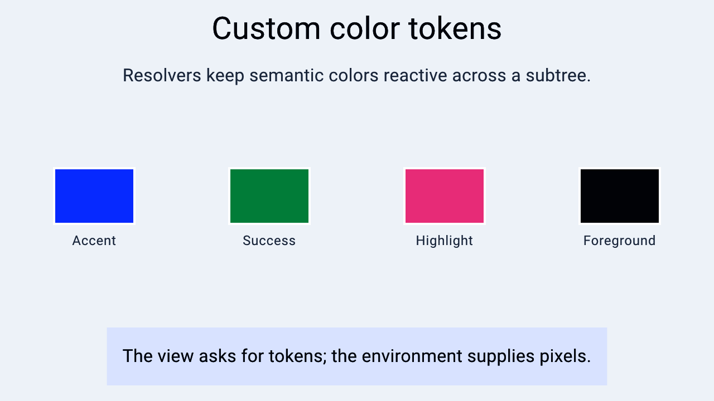

# Resolvers and hooks

> **In this chapter, you will:**
> - Understand how a design token like `theme_color::Accent` becomes a reactive signal
> - Implement `Resolvable` for your own color and font tokens and install their signals
> - Erase and transform resolvables with `AnyResolvable<T>` and `Map`
> - Intercept a component before it renders with `Hook<C>`
> - Know when a signal still needs `Dynamic`, and when it does not

When you write `.foreground(theme_color::Accent)`, nothing in that expression holds a color. `Accent` is a *token*: a zero-sized value that knows how to find its color in the `Environment` and hand back a **signal**. When the system switches to dark mode the signal fires and the affected views update. Nothing is rebuilt and nothing is diffed.



*A Hydrolysis preview of custom color tokens resolved through the environment. [Example source](https://github.com/water-rs/book/tree/main/examples/book-visuals).*

`Resolvable`, `AnyResolvable` and the `resolve` module are re-exported by the `waterui` facade, so this chapter needs no dependency beyond `waterui`.

## The Resolvable trait

```rust,ignore
pub trait Resolvable: Debug + Clone {
    type Resolved;

    fn resolve(&self, env: &Environment) -> impl Signal<Output = Self::Resolved>;
}
```

The return type is the whole design. `resolve` does not produce a value, it produces a signal, so three things follow:

1. A backend can inject a `Computed<WorkingColor>` that tracks the system appearance.
2. Every view that read the token subscribes to that signal and updates on its own.
3. There is no rebuild step, so a theme change costs one signal emission per affected leaf.

```text
Backend                   Environment                 View
   |                           |                        |
   | 1. Computed signal        |                        |
   |-------------------------->|                        |
   | 2. Theme::install         |                        |
   |-------------------------->|                        |
   |                           | 3. Accent.resolve(env) |
   |                           |<-----------------------|
   |                           | 4. signal              |
   |                           |----------------------->|
   | 5. dark mode toggled      |                        |
   |-------------------------->| 6. signal fires        |
   |                           |----------------------->|
```

## What a color resolves to

A color token resolves to `WorkingColor`, the single color type every backend and the graphics engine share: linear Display P3 components plus alpha, in `waterui::color`. It has `WorkingColor::BLACK`, `WHITE` and `TRANSPARENT`, `new([r, g, b, a])` and `with_alpha`. You rarely build one by hand; every color space type converts into it (`Srgb`, `P3`, `Oklch` all implement `From<...> for WorkingColor`), and `waterui::color::working` holds the conversion helpers (`to_oklch`, `from_oklch`, `to_srgb`, `lerp`, `with_headroom`).

`Color`, the type modifiers accept, is a newtype over `AnyResolvable<WorkingColor>`. Anything that implements `Resolvable<Resolved = WorkingColor>` converts into it, which is why a bare token, an `Srgb` and a `Map` can all be passed to `.foreground(...)`.

## The built-in color tokens

`waterui::theme::color` defines the tokens, each a unit struct created by one `define_color_token!` macro and implementing `Resolvable<Resolved = WorkingColor>`:

- Surfaces: `Background`, `Surface`, `SurfaceVariant`, `Border`
- Text: `Foreground`, `MutedForeground`, `TertiaryForeground`, `DisabledForeground`
- Accent: `Accent`, `AccentContainer`, `AccentForeground`, `Tertiary`, `TertiaryContainer`
- Selection: `SelectionContainer`, `SelectionForeground`, `UnemphasizedSelection`
- Error and overlay: `Error`, `ErrorForeground`, `Scrim`

The prelude imports the module as `theme_color`.

`Theme` is a `Plugin`. Its `ColorSettings` builder takes `impl IntoSignal<WorkingColor>` per slot, so a constant color and a reactive `Binding` both work, and installing it stores one signal per slot through `theme::install_color_signal::<Token>`. For a built-in token that function also mirrors the signal into the matching key in `waterui::graphics::color` (`Accent` into `AccentColor`, and so on), so GPU-drawn primitives track the same value.

Resolution is a contract: a token whose slot was never installed is a contract violation. A debug build panics with

```text
WaterUI color token `waterui::theme::color::Accent` is not installed in the environment, so it resolves opaque black
```

and a release build logs the same message through `tracing` and resolves opaque black. The same applies to `theme::current_color_scheme(env)`, which falls back to the light scheme. When you need to ask without committing, use the companions that return an `Option`: `theme::installed_color_signal::<Token>(env)` and `theme::installed_color_scheme(env)`.

Practical consequence: a bare `Environment::new()` cannot render themed views. Install a backend or a `Theme` first.

## Implementing your own token

A token is a unit struct plus a lookup. `install_color_signal` and `installed_color_signal` are generic over the slot type, so your token uses exactly the mechanism the built-in ones use. Here is a token, the plugin that installs its signal, and a view that uses it:

```rust
use waterui::color::{Srgb, WorkingColor};
use waterui::prelude::*;
use waterui::theme::{install_color_signal, installed_color_signal};
use waterui::{Plugin, Resolvable, contract_violation};

#[derive(Debug, Clone, Copy)]
pub struct BrandColor;

impl Resolvable for BrandColor {
    type Resolved = WorkingColor;

    fn resolve(&self, env: &Environment) -> impl Signal<Output = Self::Resolved> {
        installed_color_signal::<Self>(env).unwrap_or_else(|| {
            contract_violation!("BrandColor is not installed in the environment");
            Computed::constant(WorkingColor::BLACK)
        })
    }
}

pub struct BrandPlugin;

impl Plugin for BrandPlugin {
    fn install(self, env: &mut Environment) {
        let signal = Computed::constant(Srgb::new_u8(0, 122, 255).resolve());
        install_color_signal::<BrandColor>(env, signal);
    }
}

fn brand_title() -> impl View {
    text("Water").foreground(BrandColor).install(BrandPlugin)
}
```

The fallback arm follows the framework's own rule for tokens: panic in a debug build, log in a release build. `Srgb::resolve()` with no arguments is the inherent conversion to `WorkingColor`; the `Resolvable` method of the same name takes an environment.

A constant signal is the simplest case. Feed it a `Computed` derived from the installed color scheme instead and the brand color follows dark mode with no further work:

```rust
use waterui::color::{Srgb, WorkingColor};
use waterui::prelude::*;
use waterui::theme::{ColorScheme, current_color_scheme};

fn brand_for_scheme(env: &Environment) -> Computed<WorkingColor> {
    current_color_scheme(env)
        .map(|scheme| match scheme {
            ColorScheme::Light => Srgb::new_u8(0, 90, 200).resolve(),
            ColorScheme::Dark => Srgb::new_u8(100, 170, 255).resolve(),
        })
        .computed()
}
```

In `BrandPlugin::install`, pass `brand_for_scheme(env)` to `install_color_signal` in place of the constant.

`.foreground(...)`, `.tint(...)` and `.border(...)` take `impl Into<Color>`, so the token drops straight into view code: `text("Water").foreground(BrandColor)`.

## Fonts: slots and ResolvedFont

Fonts follow the same shape with a different output. A font token resolves to `ResolvedFont`: size, weight, optional family and design, line height and letter spacing. The theme's type scale has six slots, `Body`, `Title`, `Headline`, `Subheadline`, `Caption` and `Footnote` in `waterui::text::font`. Each implements `FontSlot`, whose associated constant `FontSlot::DEFAULT` is the framework-wide default for that slot, and each implements `Resolvable<Resolved = ResolvedFont>`.

Override slots with `FontSettings` through `Theme`. `FontSettings::default_scale()` returns every slot at its `DEFAULT`; `FontSettings::new()` starts empty and installs only what you set:

```rust
use waterui::prelude::*;
use waterui::text::font::{FontWeight, ResolvedFont};

fn app_theme() -> Theme {
    Theme::new().fonts(
        FontSettings::new()
            .body(ResolvedFont::new(17.0, FontWeight::Normal))
            .title(ResolvedFont::new(28.0, FontWeight::Bold)),
    )
}
```

A font slot is stored as `Store<Token, Computed<ResolvedFont>>`, which `theme::install_font_signal::<Token>` writes and `env.query::<Token, Computed<ResolvedFont>>()` reads. That is the keyed-slot mechanism the [Plugins](07-plugins.md) chapter describes, so your own font token is a `Resolvable` that queries it, wrapped in `Font::new`:

```rust
use waterui::prelude::*;
use waterui::text::font::{Font, FontWeight, ResolvedFont};
use waterui::{Resolvable, contract_violation};

#[derive(Debug, Clone, Copy)]
struct CodeFont;

impl Resolvable for CodeFont {
    type Resolved = ResolvedFont;

    fn resolve(&self, env: &Environment) -> impl Signal<Output = Self::Resolved> {
        env.query::<Self, Computed<ResolvedFont>>()
            .cloned()
            .unwrap_or_else(|| {
                contract_violation!("CodeFont is not installed in the environment");
                Computed::constant(ResolvedFont::new(14.0, FontWeight::Normal))
            })
    }
}

fn snippet() -> impl View {
    text("let x = 1;").font(Font::new(CodeFont))
}
```

A plugin installs its value with `install_font_signal::<CodeFont>(env, signal)`, exactly as `FontSettings` does for the built-in slots.

Note that the six built-in slot tokens are stricter than your own: they `expect` their slot, so resolving `Body` in an environment with no installed type scale panics in every build. Backends install the full scale, and `FontSettings::default_scale()` is how a test environment gets one.

## AnyResolvable\<T\>

Many types resolve to the same output. A color can come from an sRGB literal, a theme token or a derived expression; `AnyResolvable<T>` erases the difference:

```rust
use waterui::color::{Srgb, WorkingColor};
use waterui::prelude::*;
use waterui::AnyResolvable;

fn sources() -> (AnyResolvable<WorkingColor>, AnyResolvable<WorkingColor>) {
    let from_srgb = AnyResolvable::new(Srgb::new_u8(255, 0, 0));
    let from_token = AnyResolvable::new(theme_color::Accent);
    (from_srgb, from_token)
}
```

`AnyResolvable<T>` implements `Resolvable<Resolved = T>` itself, so it composes anywhere a resolvable is expected, and its inherent `resolve` returns a concrete `Computed<T>` rather than `impl Signal`: the type you can store, clone and pass on. `Color` and `Font` are built exactly this way.

## The Map combinator

`Map<R, F>` derives a variation of a token without losing reactivity. It lives in `waterui::resolve`:

```rust
use waterui::color::WorkingColor;
use waterui::prelude::*;
use waterui::resolve::Map;

fn translucent_accent() -> Color {
    Color::new(Map::new(theme_color::Accent, |color: WorkingColor| {
        color.with_alpha(0.5)
    }))
}
```

The closure runs on each emission, so when `Accent` changes the derived value changes with it. `Map` implements `Resolvable` (its `resolve` is `self.resolvable.resolve(env).map(func)`), which is how `Color::lighten`, `Color::darken` and `Color::saturate` are built. Reach for `Map` when you want a derived token; reach for those methods, or `Color::with_opacity`, when you just want a lighter or fainter color.

The closure receives `WorkingColor`, the concrete working-space value, not a `Color`. Convert with the helpers in `waterui::color::working` when you want to adjust it in a perceptual space.

## Hooks: intercepting a component

Resolvers handle values. Hooks handle views.

A view that implements `ConfigurableView` splits into a configuration and a renderer:

```rust,ignore
pub trait ConfigurableView: View {
    type Config: ViewConfiguration;
    fn config(self) -> Self::Config;
}

pub trait ViewConfiguration: 'static {
    type View: View;
    fn render(self) -> Self::View;
}
```

When such a view's body runs, it looks for a `Hook<Config>` in the environment. If one is present, the hook receives the environment and the configuration and returns a view; otherwise the configuration goes to the backend as usual. The environment a hook receives has **that hook removed**, which is what lets your closure end with `config.render()` without recursing forever.

### Installing one

`Environment::insert_hook` takes a closure `Fn(&Environment, Config) -> impl View`:

```rust
use waterui::component::button::ButtonConfig;
use waterui::prelude::*;
use waterui::view::ViewConfiguration;
use waterui::Plugin;

pub struct BorderedButtonsPlugin;

impl Plugin for BorderedButtonsPlugin {
    fn install(self, env: &mut Environment) {
        env.insert_hook(|_env, config: ButtonConfig| {
            config.render().style(ButtonStyle::Bordered)
        });
    }
}
```

Install it with `env.install(BorderedButtonsPlugin)` for the app or `.install(BorderedButtonsPlugin)` on a subtree, and every button underneath is drawn bordered without a single call site changing, including buttons that asked for another style.

`ButtonConfig` keeps its fields private and is `#[non_exhaustive]`, so a hook reads it through getters (`label()`, `action()`, `style()`, `size()`) or takes it apart with `into_parts()`. `render()` turns it back into a `Button`, on which you call the usual builder methods. The `Label` stays typed, so a hook can restyle or wrap the label but cannot strip the semantic text that assistive technology reads.

Hooks are the right tool for consistent styling, experiment flags and instrumentation. They are the wrong tool for anything a modifier, a theme token or an ambient setting already expresses. If you only want a default, `.install(ButtonStyle::Bordered)` does it with no hook: a `ButtonStyle` installed as a plugin applies to the buttons that left their style `Automatic` and leaves explicit choices alone.

## When a signal still needs Dynamic

This section applies the same rule the framework's authoring guidance gives for `watch`: it is not the reactive primitive, it is the escape hatch. Most of the time a resolved signal never touches `Dynamic`. A `Computed<T>` feeds directly into a signal-taking input, and `text!` maps over any signal in scope:

```rust
use waterui::env::use_env;
use waterui::prelude::*;
use waterui::text::font::Headline;
use waterui::{Resolvable, contract_violation};

#[derive(Debug, Clone, Copy)]
struct AppTitle;

impl Resolvable for AppTitle {
    type Resolved = Str;

    fn resolve(&self, env: &Environment) -> impl Signal<Output = Self::Resolved> {
        env.query::<Self, Computed<Str>>()
            .cloned()
            .unwrap_or_else(|| {
                contract_violation!("AppTitle is not installed in the environment");
                Computed::constant(Str::from(""))
            })
    }
}

fn title_bar() -> impl View {
    use_env(|env: Environment| {
        let title = AppTitle.resolve(&env).computed(); // Computed<Str>
        text!("{title}").font(Headline)
    })
}
```

Store the value with `env.store::<AppTitle, _>(Computed::constant(Str::from("WaterUI")))`, which takes the environment by value and returns the extended one. When the stored signal emits, the update is precise: the text node re-renders and nothing else does. A reactive color works the same way: hand the token or the signal to the modifier and the modifier subscribes.

Three things replace nearly every use of `watch` or `Dynamic`:

- a reactive **text** is `text!("{signal}")`, not `watch` plus `format!`;
- a reactive **value** is the signal itself, passed to a modifier or component that takes `impl IntoComputed<T>` or similar;
- a changing **set of views** is a collection (`ForEach`, `Lazy::for_each`, `List`), which diffs by id instead of replacing everything.

Check those three first, every time. `Dynamic` is for the remaining case, where the *shape* of the subtree depends on the value and no signal-aware API or collection applies. `Dynamic::new()` gives you a handler and a view to drive manually; `watch` (in the prelude) wraps a signal:

```rust
use waterui::prelude::*;

fn swappable() -> impl View {
    let (handler, view) = Dynamic::new();
    handler.set(text("Initial content"));
    vstack((
        view,
        // Each `set` replaces the whole subtree.
        button("Swap").action(move || handler.set(text("Updated content"))),
    ))
}
```

Every replacement tears down the subtree and discards the state the previous one owned. A `Computed<V>` is *not* itself a view even when `V: View`: if you really do have a signal of views, hand it to `watch(signal, |view| view)` deliberately.

---

That is the bottom of the stack: tokens resolve to signals, hooks rewrite configurations, and everything above is built from those two ideas. Good next steps are building a token set for your own design system, or reading [Plugins](07-plugins.md) again now that you know what `install` can register. For the signal rules behind `Dynamic`, see [Reactive state](../02-core/02-reactive.md); for how tokens reach styling, see [Styling](../03-ui/11-styling.md).
